# Argus Cyclist Simulator


**Argus Cyclist** is a cross-platform open-source software for indoor cycling simulation. It talks to smart trainers in real time, renders your ride in a live 3D world or on a real 3D map, and supports free rides, structured workouts, physiological assessments and an event mode built for fairs and open days. Available for Desktop and Mobile.

## Screenshots

| Choose your rider | Free Ride in the 3D world | Free Ride on the real map |
| :---: | :---: | :---: |
| 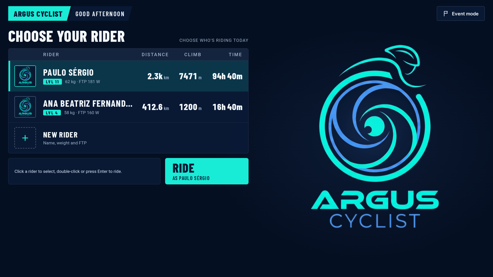 | 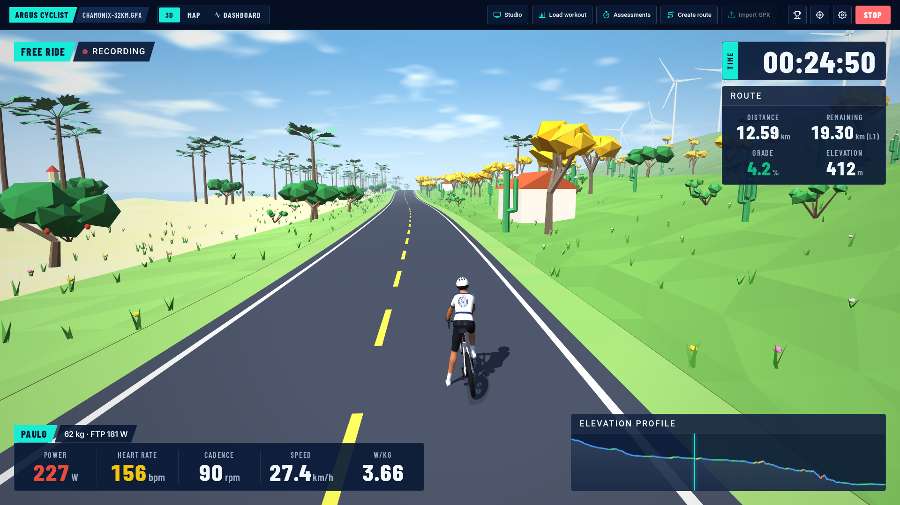 | 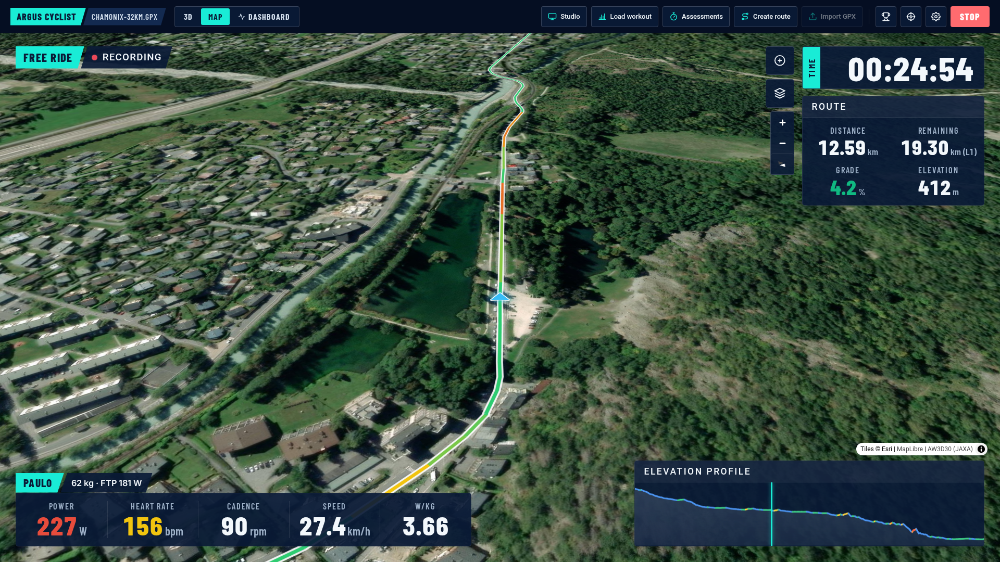 |
| **Live dashboard & workout plan** | **Studio mode** | **Athlete: profile & devices** |
| 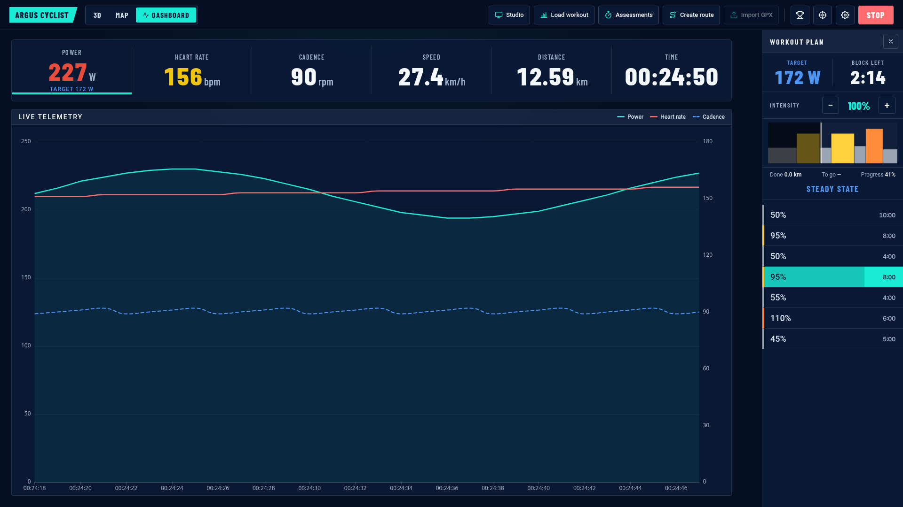 | 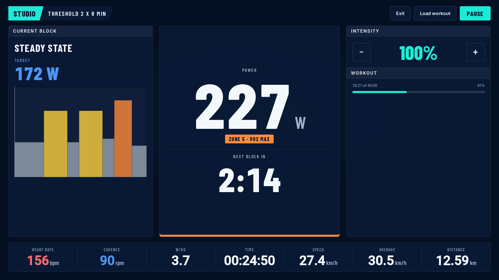 | 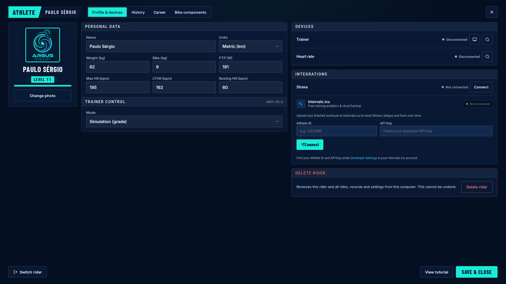 |
| **Athlete: history & records** | **Athlete: career (PMC)** | **Activity analysis** |
| 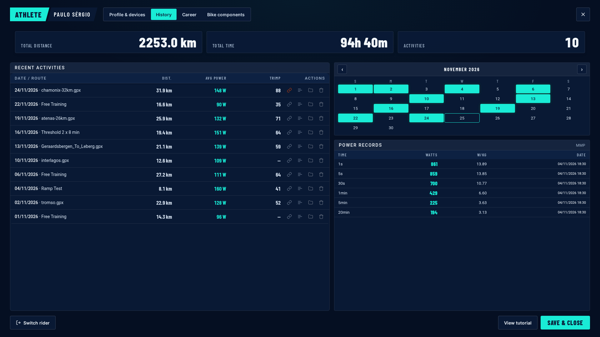 | 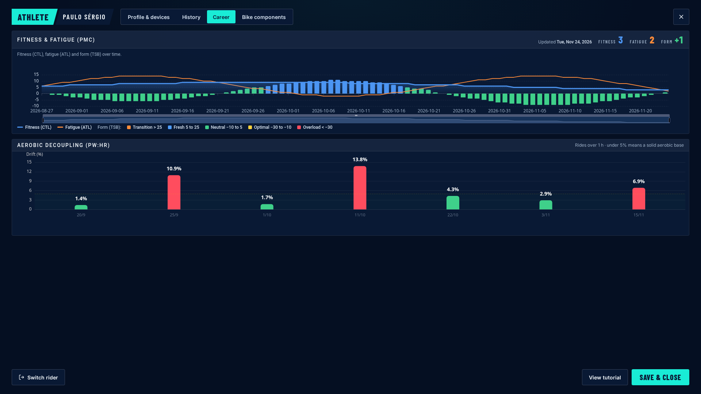 | 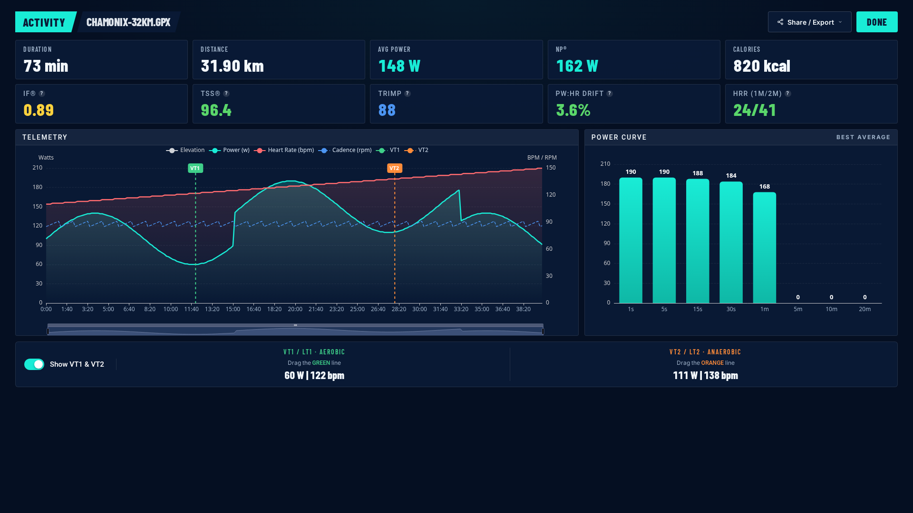 |
| **Trophy room** | **Event mode: start list** | **Event mode: ranking** |
| 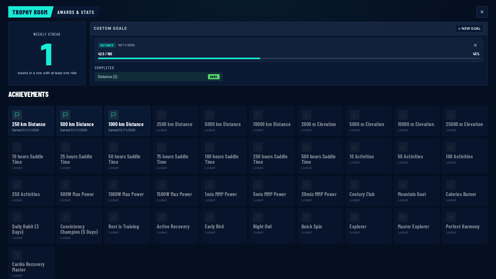 | 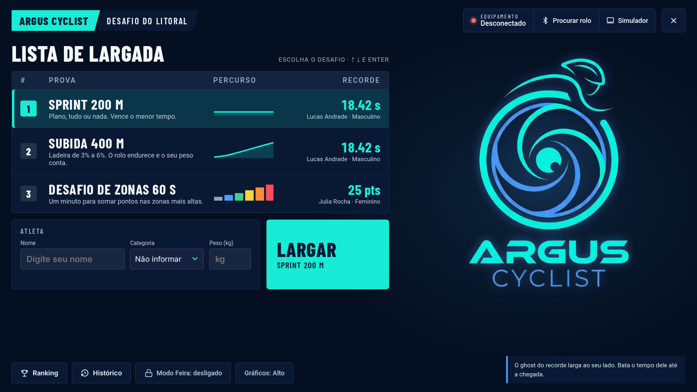 | 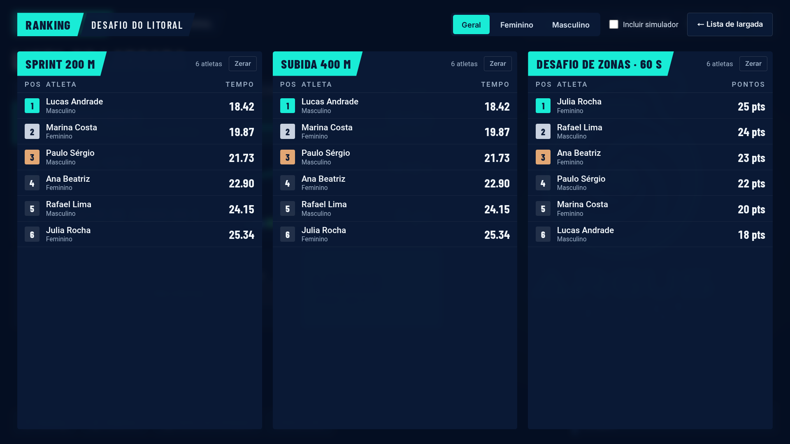 |

## Interface

The whole software follows one visual standard, taken from the sports-broadcast look of the event mode and coloured after the Argus logo.

* **One palette for every screen:** deep navy panels, aqua for actions and for *you*, blue for references (record ghost, targets), and the classic power-zone colours. Numbers use Barlow Condensed with tabular digits, text uses Inter (both bundled, no internet needed).
* **Panels over the scene:** while riding, the 3D world or the map fills the window and the data sits in panels at the corners: ride state, time, route, rider metrics and the elevation profile.
* **Elevation profile:** drawn at the screen's real resolution (HiDPI and scaled screens stay sharp), placed by real distance so the position cursor lines up, and coloured by the grade measured over ~100 m (green up to 3%, yellow 3–6%, orange 6–9%, red above 9%, blue descents).
* **Responsive layout:** checked from 1024×768 to 2560×1440; on big screens (TV / 1080p and up) the panels scale up, on narrow windows the top bar tools collapse to icons.
* **Languages:** the Free Ride software is in English; the event mode screens are in Portuguese for the public at the fair.
* **In-app dialogs:** confirmations, errors and text inputs use the app's own dialog (keyboard friendly, destructive questions start on *Cancel*) instead of the system pop-ups.
* **First-run tutorial:** a short guided tour of the main features, available again from the athlete area.

## Live 3D World

* **Custom WebGL 2 scene:** a low-poly "Litoral Potiguar" coastal world (dunes, ipê trees, cacti, wind turbines) with an animated rider, rendered by a dependency-free WebGL 2 engine. It works fully offline.
* **Follows your ride:** speed and pedalling come from the trainer; the rider sprints when power goes well above FTP.
* **Cameras:** chase, drone and cinematic views (press **C** to cycle).
* **Graphics quality:** low, medium and high presets (1×, 1.5× and 2× render resolution) to fit the computer.
* **Race furniture:** in event races the road follows the course elevation profile, start and finish gates are placed on the course, distance-to-go boards appear every 100 m and the record ghost rides next to you.

## Event Mode (fairs and open days)

A self-contained mode for running short challenges with the public, with its own start list, ranking and operator controls.

* **Start list:** pick the event, type the athlete's name, category and weight, and press **LARGAR**. The right side shows the animated Argus logo while visitors wait.
* **Sprint 200 m:** flat, all-out, fastest time wins. The record ghost starts next to you.
* **Climb 400 m:** 3% to 6% grade; the trainer resistance follows the slope and the rider's weight counts.
* **Zone Challenge 60 s:** one minute to score points; higher power zones score more per second, and holding Z5+ unlocks the top multiplier. To be fair to every visitor, the zones are scaled to the weight measured on the scale (reference FTP = 2.5 W/kg × weight) instead of a fixed FTP.
* **Broadcast HUD:** countdown, live classification tower, gap to the record, and a finish screen with podium; the result screen hands over to the next athlete after 20 seconds.
* **Rankings by category:** overall, female and male rankings per event, with an operator reset per event.
* **Fair Mode (operator lock):** blocks the virtual simulator so only real trainer efforts reach the ranking.

## Cross-Platform: Now on Mobile (Android)

Argus Cyclist isn't just for desktop anymore. Powered by **Capacitor.js**, the simulator now runs natively on Android devices, transforming your smartphone into a high-end cycling head unit.

* **Immersive Mobile HUD:** A fully responsive, landscape-forced "gaming mode" UI to maximize map visibility.
* **Native Bluetooth LE:** Direct connection to smart trainers and heart rate monitors using the mobile device's built-in Bluetooth antenna.
* **JS Physics Engine:** A dedicated JavaScript physics engine ensures accurate speed calculations (accounting for drag, rolling resistance, and gravity) directly on the mobile device, without requiring the Go backend.
* **Local File Parsing:** Import `.GPX` routes and `.ZWO` workout plans natively from your phone's storage.

## Simulation & Connectivity

* **Smart Trainer Support (BLE):** Controls trainers over Bluetooth LE using FTMS (desktop) or FE-C messages carried over BLE (desktop and Android), and reads Cycling Power and Heart Rate sensors. Native ANT+ (USB dongle) is not supported. Tested with a ThinkRider X2 MAX.
* **Built-in Simulator:** A virtual trainer lets you try every screen without hardware.
* **Physics Engine:** Real-time speed calculation based on power (Watts), rider weight, bike weight, rolling resistance, and aerodynamic drag.
* **Grade Simulation:** The trainer automatically adjusts resistance based on the virtual terrain slope.
* **Cloud Integrations (optional):** Manual upload to Strava (OAuth 2.0, with automatic token refresh and one retry on 401) and to Intervals.icu (API key). A sync-queue table exists in the schema, but background retries are not implemented yet.
* **Session Recovery:** The active session is snapshotted to disk every few seconds; after a crash, the next start offers to recover it and save the `.FIT` file.

## Training

* **Live Dashboard:** Big metric row (power, heart rate, cadence, speed, distance, time) and a live telemetry chart of power, heart rate and cadence.
* **Structured Workouts:** Load `.ZWO` plans and let ERG mode set the power of each block. The workout plan panel shows the target, the time left in the block, the intensity (adjustable ±5%), the zone-coloured block list and the overall progress.
* **Studio Mode:** A full-screen, telemetry-only view for indoor sessions: current block and target, big power with the current zone, time to the next block, intensity controls and workout progress.
* **Fitness Assessments:** Ramp Test, 20-minute FTP Test and 5-minute VO2max protocols, with a confirmation of the baseline FTP the test is scaled from.
* **Route Editor:** Draw custom routes by clicking on the map and save them as `.GPX`.

## Athlete Area

* **Multi-Profile System:** Create and manage multiple riders on the same device. Each profile has its own level, XP, FTP, weight settings, and activity history. Riders are chosen from a start-list style home screen.
* **Profile & Devices:** Personal data (weight, bike weight, FTP, heart-rate thresholds), trainer control mode (simulation or ERG), device connections and cloud integrations in one tab.
* **History:** Totals, recent activities, a monthly calendar and your power records (MMP).
* **Career Dashboard:** Track your long-term evolution with the Performance Management Chart (PMC), mapping your Fitness (CTL), Fatigue (ATL), and Form (TSB), plus an Aerobic Decoupling (Pw:HR) history for rides over one hour (under 5% means a solid aerobic base).
* **Bike Components:** Wear tracking per component (see below), as a regular tab of the athlete area.
* **Safe rider deletion:** A rider can only be deleted from inside their own athlete area, never from the home list, and never while a ride is recording.

### Gamification & Progression

* **Leveling System:** Earn **XP (Experience Points)** passively by riding, with more XP for climbing and long distances.
* **Persistent Profile:** Your stats (Level, Total XP, FTP, Weight) are saved locally using SQLite.
* **Trophy Room & Custom Goals:** Set personal training targets (Distance, Elevation, or Saddle Time) with deadlines and track their progress. Weekly streak counter and achievement cards for distance, climbing, saddle time, activities and power milestones.
* **Balanced Achievement System:** 11 consistency, recovery, routine, exploration, balance, and cardiovascular milestones (Daily Habit, Consistency Champion, Rest is Training, Active Recovery, Early Bird, Night Owl, Quick Spin, Explorer, Master Explorer, Perfect Harmony, Cardio Recovery Master) with live notifications.

### Real 3D Map

* **MapLibre Integration:** Powered by MapLibre GL JS with raster-DEM 3D terrain (1.5× exaggeration) and a chase camera. Map tiles are fetched online; the simulation itself works offline from the local GPX.
* **Map Styles:** Three switchable styles: **Satellite** (Esri imagery), **Day** (OpenFreeMap, with 3D buildings) and **Tactical** (dark).
* **Smart Route Rendering:** Route lines change colour with the gradient, and render correctly behind 3D buildings.
* **Smooth Animation:** Position updates are throttled to 150 ms and the camera eases between them, so movement stays smooth regardless of the sensor rate (~1 Hz).

### Advanced Analytics & Tools

* **Deep Activity Analysis:** Review your rides with Normalized Power (NP), Intensity Factor (IF), TSS, TRIMP, aerobic decoupling and Heart Rate Recovery (HRR in 1 and 2 minutes after the ride). Telemetry chart with draggable VT1/VT2 threshold markers and a Power Curve (MMP) chart; export the analysis as PDF or PNG.
* **Post-Ride Summary:** Instant feedback upon workout completion with core stats, time in power zones, XP earned and quick "Upload to Strava / Intervals.icu" actions.
* **GPX Routes:** Ride real-world routes by importing `.GPX` files.
* **Data Export:** Automatically generates `.FIT` files compatible with Strava, Garmin Connect, and TrainingPeaks.

### AI Coach — Local LLM Training Assistant

* **Ollama Integration:** Connect to any locally running Ollama model (e.g., `qwen2.5:3b`) for a fully private, offline AI assistant.
* **Personalized Workout Generation:** Ask the AI to create a structured workout, and it generates a complete ZWO plan tailored to your FTP, weight, level, and recent training history.
* **Context-Aware Chat:** The assistant has access to your profile data (FTP, level, streak, recent activities) to give informed training advice.
* **Conversation History:** All chats are saved per profile, allowing you to revisit past recommendations.
* **One-Click Workout Loading:** AI-generated workouts can be saved as `.ZWO` files and loaded directly into the simulator with a single click.

### Bike Component Wear Tracking

* **Component Registry:** Add bike components (Chain, Cassette, Chainrings, Bottom Bracket, Tires, etc.) with brand, model, and install date.
* **Automatic Wear Calculation:** Wear is calculated as `(accumulated distance / expected lifespan) × 100%` and updated automatically after every workout.
* **Visual Wear Status:** Color-coded indicators — Green (< 50% wear), Yellow (50–80%), Red (≥ 80%) — with a "Replace soon" warning for critical components.
* **Replacement History:** Log replacements with reason and mileage at time of replacement for full maintenance traceability.
* **Customizable Lifespan:** Set expected lifespan in kilometers for each component type based on manufacturer recommendations or personal experience.

## Technologies

* **Backend:** Go (Golang)
* **Frontend:** JavaScript (ES6+), Vite, MapLibre GL JS + OSRM, Apache ECharts
* **3D:** Custom WebGL 2 engine (no dependencies)
* **Native Wrappers:** Wails (Desktop) & Capacitor (Android)
* **Database:** SQLite (for local user data)
* **AI:** Ollama (local LLM inference)
* **Fonts:** Barlow Condensed and Inter (bundled with `@fontsource`)

## Prerequisites

Before starting, ensure you have installed:

* [Go](https://go.dev/) (v1.20+)
* [Node.js](https://nodejs.org/) & npm
* [Wails CLI](https://wails.io/) (`go install github.com/wailsapp/wails/v2/cmd/wails@latest`)
* [Android Studio](https://developer.android.com/studio) (for mobile compilation)
* A browser engine with **WebGL 2** for the 3D world (WebView2 on Windows, WebKitGTK 4.1 on Linux)

## Installation and Setup

1. **Clone the repository:**

    ```bash
    git clone https://github.com/SoNdA11/argus-cyclist.git
    cd argus-cyclist
    ```

2. **Install dependencies:**

    ```bash
    # Go dependencies
    go mod tidy

    # Frontend dependencies
    cd frontend
    npm install
    cd ..
    ```

## How to Run

To start the application in development mode (with Hot Reload):

```bash
./run-dev.sh
```

The script runs `wails dev` with the WebKitGTK 4.1 build tag and skips the production frontend build when one already exists (the dev server serves the UI). Force a full build with `FULL_BUILD=1 ./run-dev.sh`, or call `wails dev` directly on other platforms.

## Troubleshooting: Windows Bluetooth (BLE)

* **Debug logs**: set `ARGUS_BLE_DEBUG=1` before starting the app to print detailed scan diagnostics to the terminal.
* **Discovery on Windows**: some Windows Bluetooth stacks do not expose advertised Service UUIDs during scanning. In this case, Argus will list nearby **named** BLE devices and validate FTMS/HR services after you select and connect.
* **Permissions**: typically you do **not** need to run as Administrator to scan BLE, but you must have Bluetooth enabled and allow the app to use Bluetooth in Windows privacy settings.

## Troubleshooting: Windows "Protect your PC" Warning

When launching the downloaded `.exe` on Windows for the first time, you may encounter a blue "Windows protected your PC" (Microsoft Defender SmartScreen) warning.

This happens because Argus Cyclist is an independent open-source project and the executable is currently not signed with a paid Authenticode Code Signing Certificate. The application is completely safe.

**To run the simulator:**

1. Click on **More info** text in the warning dialog.
2. Click the **Run anyway** button that appears at the bottom.
