# Como usar este guia

Este guia explica, slide por slide, tudo o que aparece na apresentação. Em cada capítulo você encontra:

- **O que aparece na tela:** a descrição de cada elemento e do que entra a cada clique.
- **Conceitos:** os termos do slide, explicados do zero.
- **De onde vêm os números:** a fonte e, quando for o caso, a conta.
- **Roteiro da fala:** o que dizer, no tempo previsto.
- **Perguntas prováveis:** o que a banca pode perguntar e como responder.
- **No TCC:** onde o assunto está no documento que a banca já leu.

No fim há um glossário, a lista de números para decorar, os pontos delicados (com respostas honestas), um banco de perguntas extras e o checklist do dia.

**Sugestão de estudo.** Leia uma vez inteiro. Depois ensaie com o deck aberto, um capítulo por vez, falando em voz alta. Na véspera, releia só os "Roteiros" e os "Pontos delicados".

## Teclas da apresentação

| Tecla | O que faz |
|---|---|
| → ou espaço | próximo clique ou próximo slide |
| ← | volta |
| `S` | visão do apresentador: notas, cronômetro e próximo slide |
| `F` | tela cheia |
| `T` | alterna tema claro (padrão) e escuro |
| `B` ou `.` | tela preta |
| `Esc` | visão geral dos slides |
| clique numa imagem | abre a galeria ampliada (slides 3 e 14); ← → passam, `Esc` fecha |

A visão do apresentador (`S`) mostra se você está adiantado ou atrasado em relação aos tempos planejados de cada slide. Use-a nos ensaios.

## A história em um minuto

A apresentação conta uma história em seis passos:

1. **O mundo:** o ciclismo virtual já é esporte de verdade, de Copa Brasil a Mundial (slide 3).
2. **O problema:** o ciclista usa quatro aplicativos, exporta arquivos à mão e não sabe como os números são calculados (slides 4 e 5).
3. **A proposta:** um único fluxo aberto, do GPX ao histórico, servindo a reconhecimento, exploração e treino (slide 6).
4. **Como foi feito:** pelo método DSR, com uma arquitetura em camadas, conversando com o rolo por Bluetooth e tratando os dados em tempo real (slides 7 a 11).
5. **A evidência:** as métricas com fórmula aberta, dez meses de uso real, as funcionalidades e os requisitos atendidos (slides 12 a 15).
6. **A conclusão:** funciona no desktop, cada número pode ser conferido, e os limites estão declarados (slide 16).

A frase que amarra tudo: **"o fluxo funciona, e cada número pode ser conferido"**.

## Tabela de tempos

| # | Slide | Tempo |
|---|---|---|
| 1 | Capa | 0:20 |
| 2 | Sumário | 0:20 |
| 3 | O que é ciclismo virtual | 1:20 |
| 4 | O fluxo do ciclista é fragmentado | 1:00 |
| 5 | As peças existem, mas não juntas | 1:10 |
| 6 | Um fluxo para três usos | 0:50 |
| 7 | Construir, usar e corrigir, em ciclos | 1:00 |
| 8 | Como o Argus foi construído | 1:10 |
| 9 | Núcleo em Go, interface web compartilhada | 1:40 |
| 10 | Como o Argus conversa com o rolo | 1:30 |
| 11 | Do sensor até o ciclista | 1:15 |
| 12 | Cada número tem fórmula e limite | 1:50 |
| 13 | Dez meses de uso real | 1:00 |
| 14 | Do treino à análise | 1:00 |
| 15 | Requisitos atendidos | 0:50 |
| 16 | Conclusão | 1:15 |
| 17-18 | Referências | 0:10 |
| 19 | Obrigado | 0:15 |
| | **Total** | **17:55** |

Sobram cerca de 2 min 05 s dos 20 minutos. **Se atrasar**, corte nesta ordem:

1. **Slide 9 (Archify):** fale só "interface, orquestrador, laço, Bluetooth, rolo" e siga. Economiza cerca de 1 min.
2. **Slide 14 (galeria):** uma frase. Economiza cerca de 40 s.
3. **Slide 5 (estado da arte):** aponte só a linha do Argus. Economiza cerca de 30 s.

# Slide 1 · Capa

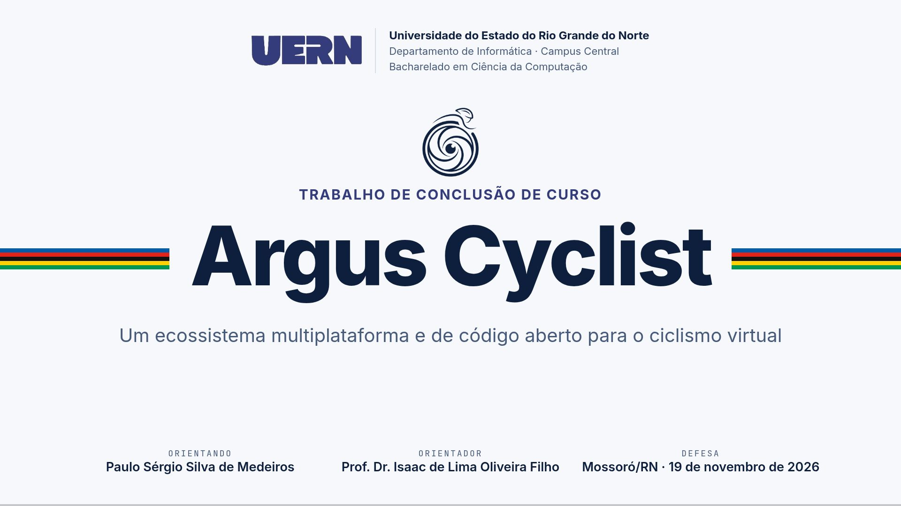

## O que aparece na tela

- **Cabeçalho:** o logo da UERN com "Universidade do Estado do Rio Grande do Norte · Departamento de Informática · Campus Central · Bacharelado em Ciência da Computação".
- **Centro:** o símbolo do Argus (sem o nome, que já está no título), o rótulo "Trabalho de Conclusão de Curso" em índigo e o título "Argus Cyclist", com o subtítulo "Um ecossistema multiplataforma e de código aberto para o ciclismo virtual".
- **Faixa arco-íris:** cinco listras finas (azul, vermelho, preto, amarelo e verde) atravessam o slide e são interrompidas pelo nome, como a faixa no peito da camisa do campeão mundial da UCI. Elas se desenham da esquerda para a direita quando o slide abre.
- **Rodapé:** orientando, orientador (Prof. Dr. Isaac de Lima Oliveira Filho) e a defesa (Mossoró/RN · 19 de novembro de 2026).

## Conceitos

- **Ecossistema:** não é um aplicativo único. São o app desktop (Windows e Linux), o app Android e os arquivos abertos (GPX, FIT, ZWO) que conversam com outras plataformas.
- **Multiplataforma:** roda no desktop e no Android com a mesma interface.
- **Código aberto:** o código está público no GitHub sob a licença GPLv3.

## Roteiro da fala (20 s)

"Bom dia. Eu sou o Paulo Sérgio, e apresento o Argus Cyclist, um software de código aberto para ciclismo virtual, registrado no INPI, orientado pelo professor Isaac."

## No TCC

Capa e resumo.

# Slide 2 · Sumário

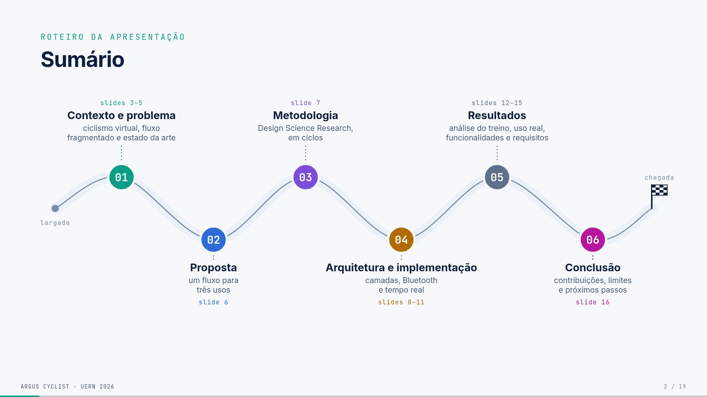

## O que aparece na tela

Rótulo "Roteiro da apresentação" e título "Sumário". O roteiro é desenhado como uma **rota de ciclismo**: uma estrada sinuosa vai da "largada" à "chegada" (bandeira quadriculada) e se desenha quando o slide abre. As seis seções são paradas na estrada, círculos numerados de 01 a 06 na cor da seção, que aparecem uma a uma, sem cliques. As paradas 01, 03 e 05 ficam no alto, com o texto acima; as 02, 04 e 06 ficam embaixo, com o texto abaixo. Cada texto traz o título, a descrição e o intervalo de slides. Um ponto amarelo (o ciclista) percorre a rota sem parar e passa por trás das paradas:

| # | Seção | Descrição | Slides |
|---|---|---|---|
| 01 | Contexto e problema | ciclismo virtual, fluxo fragmentado e estado da arte | 3–5 |
| 02 | Proposta | um fluxo para três usos | 6 |
| 03 | Metodologia | Design Science Research, em ciclos | 7 |
| 04 | Arquitetura e implementação | camadas, Bluetooth e tempo real | 8–11 |
| 05 | Resultados | análise do treino, uso real, funcionalidades e requisitos | 12–15 |
| 06 | Conclusão | contribuições, limites e próximos passos | 16 |

As referências (17 e 18) e o agradecimento (19) ficam fora do sumário, como é usual.

## Para que serve

Dá à banca o mapa da fala antes de começar. Cada seção tem uma cor: verde-azulado (contexto e problema), azul (proposta), roxo (metodologia), âmbar (arquitetura), cinza-azulado (resultados) e fúcsia (conclusão). O rótulo no alto de cada slide usa a cor da sua seção, para que a banca sempre saiba em que parte você está.

## Roteiro da fala (20 s)

"Vou falar do contexto e do problema, da proposta, do método, de como o Argus foi construído, dos resultados e concluir."

Não leia os cartões. Uma frase basta.

# Slide 3 · O que é ciclismo virtual

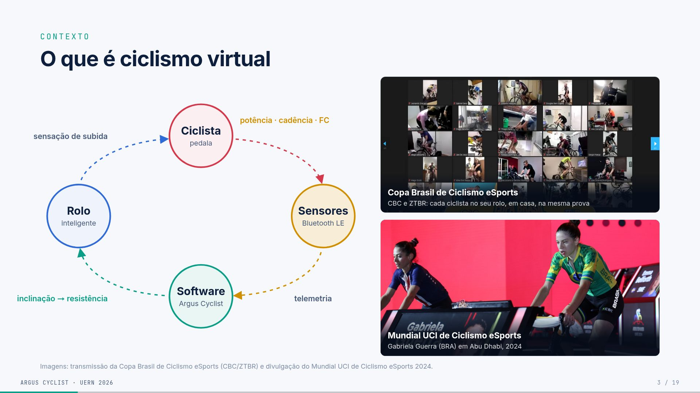

## O que aparece na tela

**À esquerda,** um ciclo com quatro círculos coloridos ligados por setas tracejadas que se movem. Cada seta tem a cor do bloco de onde sai. As cores têm significado: **Ciclista** em vermelho (o corpo, a cor da FC), **Sensores** em âmbar (a cor da potência, que eles medem), **Software** em verde-azulado (a marca Argus) e **Rolo** em azul.

- **Ciclista** (pedala) → **Sensores** (Bluetooth LE). Acima da seta: *potência · cadência · FC*.
- **Sensores** → **Software** (Argus Cyclist). Ao lado: *telemetria*.
- **Software** → **Rolo inteligente**. Ao lado: *inclinação → resistência*.
- **Rolo** → **Ciclista**. Ao lado: *sensação de subida*.

**À direita,** duas fotos (clicar amplia):

- **Copa Brasil de Ciclismo eSports (CBC e ZTBR):** uma videochamada com dezenas de ciclistas, cada um no seu rolo, em casa, na mesma prova. **Você aparece nessa chamada.**
- **Mundial UCI de Ciclismo eSports, Abu Dhabi, 2024:** Gabriela Guerra (BRA) competindo.

## Conceitos

- **Rolo inteligente (smart trainer):** aparelho onde se prende a bicicleta. Ele mede a potência e muda a resistência sozinho, recebendo comandos do software.
- **Sensores:** o próprio rolo, um medidor de potência e a cinta cardíaca mandam dados pelo Bluetooth.
- **As quatro grandezas e suas cores** (que se mantêm até o fim do deck):
  - **potência (W),** amarelo: o trabalho que o ciclista produz, a grandeza central do treino;
  - **frequência cardíaca (bpm),** vermelho: a resposta do corpo;
  - **cadência (rpm),** azul: o ritmo das pedaladas;
  - **inclinação (%),** do mapa do percurso: faz o rolo endurecer na subida.
- **Ciclismo eSports:** competição oficial em rolo. A UCI, federação internacional, organiza o Mundial; no Brasil há a Copa Brasil da CBC.

## Roteiro da fala (1:20)

"Ciclismo virtual é pedalar a sua bicicleta num rolo inteligente enquanto um software simula o percurso. O ciclo é este: eu pedalo, os sensores mandam potência, cadência e frequência cardíaca por Bluetooth, o software calcula onde eu estou no mapa e manda a inclinação de volta para o rolo, que endurece na subida. Então eu *sinto* a subida.

Guardem estas cores, que vão até o fim: potência em amarelo, frequência cardíaca em vermelho.

E isso já é esporte de verdade. Aqui é a Copa Brasil de Ciclismo eSports, da CBC com a ZTBR: cada atleta pedala em casa e a organização acompanha pela videochamada (eu estou nessa chamada). E aqui é o Mundial da UCI, em Abu Dhabi, em 2024, com a brasileira Gabriela Guerra."

## Perguntas prováveis

- **(EF) O rolo mede a potência ou estima?** O rolo inteligente mede a potência no próprio equipamento. A velocidade virtual, por outro lado, é calculada pelo modelo físico (slide 12 e glossário).
- **(Comp.) Por que Bluetooth e não ANT+?** O notebook e o celular têm Bluetooth nativo, enquanto ANT+ precisaria de um dongle USB. O Argus usa o protocolo FE-C (que nasceu no ANT+) transportado por Bluetooth (slide 10).

## No TCC

Cap. 1 (Introdução) e Cap. 2 (Estado da arte, "De simuladores a ecossistemas").

# Slide 4 · O fluxo do ciclista é fragmentado

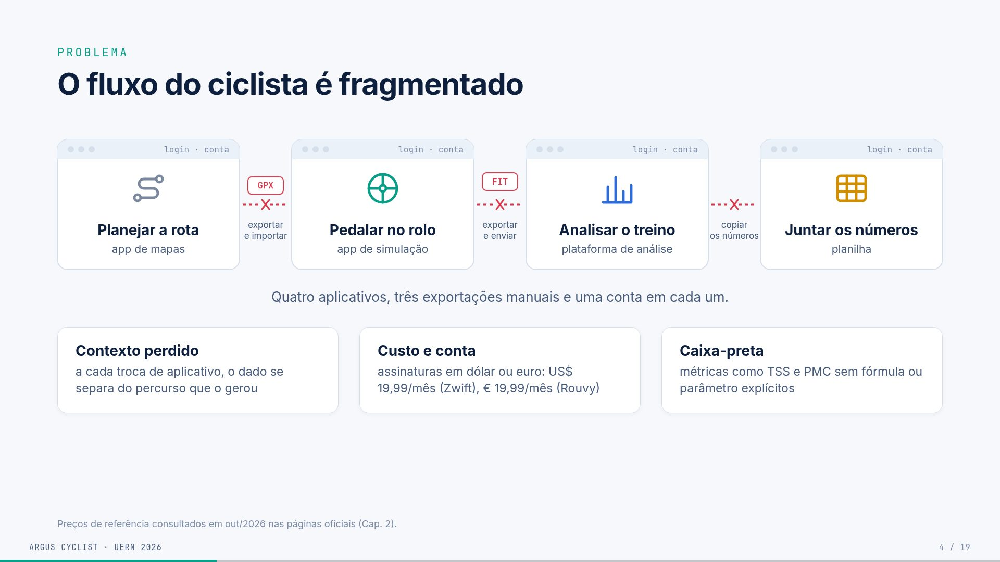

## O que aparece na tela

- **Quatro janelas de aplicativo,** que entram em sequência, cada uma com "login · conta" no topo:
  1. **Planejar a rota** (app de mapas);
  2. **Pedalar no rolo** (app de simulação);
  3. **Analisar o treino** (plataforma de análise);
  4. **Juntar os números** (planilha).
- **Entre as janelas,** elos vermelhos quebrados com um "X". Arquivos "caem" no caminho: **GPX** (exportar e importar), **FIT** (exportar e enviar) e **CSV** (copiar os números).
- **Frase:** "Quatro aplicativos, três exportações manuais e uma conta em cada um."
- **Três cartões, um por clique:**
  - **Contexto perdido:** a cada troca de aplicativo, o dado se separa do percurso que o gerou.
  - **Custo e conta:** assinaturas em dólar ou euro, como US$ 19,99/mês (Zwift) e € 19,99/mês (Rouvy).
  - **Caixa-preta:** métricas como TSS e PMC aparecem sem fórmula ou parâmetro explícitos.
- **Rodapé:** os preços foram consultados em out/2026 nas páginas oficiais (Cap. 2).

## Conceitos

- **GPX:** arquivo com o percurso (latitude, longitude, altitude). É o que se baixa de um app de mapas.
- **FIT:** arquivo binário com o registro do treino (potência, FC, cadência segundo a segundo). É o padrão da Garmin e o formato que Strava e Intervals.icu aceitam.
- **CSV:** planilha em texto.
- **TSS e PMC:** métricas de carga de treino (slides 12 e 13). Em muitos apps elas aparecem sem a fórmula.

## Roteiro da fala (1:00)

"Hoje, quem treina em casa usa quatro ferramentas: uma para montar a rota, outra para pedalar no rolo, outra para analisar e uma planilha para juntar tudo. Entre elas, o dado viaja em arquivos exportados à mão, e cada uma pede conta e login.

Isso gera três dores. O contexto se perde: o número de potência se separa da subida que o gerou. O custo se acumula, com assinaturas em dólar e euro. E a análise é uma caixa-preta: o app mostra um TSS, mas não diz como calculou.

O Argus ataca a fragmentação e a caixa-preta, mantendo o dado no seu computador."

## Perguntas prováveis

- **(Comp.) Por que não usar o Strava para tudo?** O Strava analisa, mas não controla o rolo nem simula percurso. Além disso, os dados ficam na nuvem dele.
- **De onde vêm os preços?** Das páginas oficiais, consultadas em out/2026. As referências são `zwift_pricing` e `rouvy_pricing` no TCC.

## No TCC

Cap. 1 (problema e justificativa) e Cap. 2 ("A lacuna do fluxo integrado").

# Slide 5 · As peças existem, mas não juntas

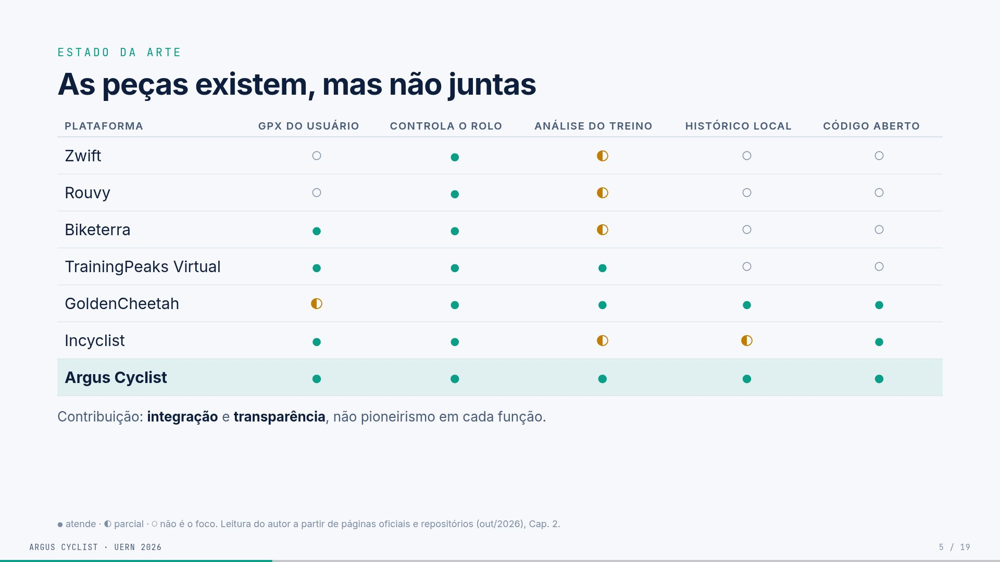

## O que aparece na tela

Uma matriz de capacidades. As linhas são as plataformas e as colunas, cinco capacidades:

| Plataforma | GPX do usuário | Controla o rolo | Análise do treino | Histórico local | Código aberto |
|---|---|---|---|---|---|
| Zwift | ○ | ● | ◐ | ○ | ○ |
| Rouvy | ○ | ● | ◐ | ○ | ○ |
| Biketerra | ● | ● | ◐ | ○ | ○ |
| TrainingPeaks Virtual | ● | ● | ● | ○ | ○ |
| GoldenCheetah | ◐ | ● | ● | ● | ● |
| Incyclist | ● | ● | ◐ | ◐ | ● |
| **Argus Cyclist** (clique) | ● | ● | ● | ● | ● |

● atende · ◐ parcial · ○ não é o foco. A leitura é do autor, a partir de páginas oficiais e repositórios (out/2026).

No clique seguinte aparece a frase: "Contribuição: **integração** e **transparência**, não pioneirismo em cada função."

## Conceitos

- **GPX do usuário:** poder pedalar um percurso que *você* escolheu, e não só os mundos prontos do app.
- **Histórico local:** os treinos ficam no seu computador, não só na nuvem da empresa.
- **TrainingPeaks Virtual:** o concorrente comercial mais parecido. Ele aceita GPX (recurso "GPXplore") e tem análise, mas é fechado e na nuvem.
- **GoldenCheetah:** software livre de análise. É muito forte em análise, mas não é um simulador de percurso.
- **Incyclist:** o mais próximo em código aberto. Simula vídeo e GPX, mas a análise é parcial.

## Roteiro da fala (1:10)

"As peças já existem separadas. Zwift e Rouvy controlam o rolo, mas são mundos fechados. O TrainingPeaks Virtual prova que o caso de uso existe, porque já deixa pedalar o seu GPX, mas é fechado. O GoldenCheetah é aberto e analisa muito bem, mas não simula o percurso. O Incyclist é o mais próximo em código aberto.

O Argus não é pioneiro em nenhuma função isolada. A contribuição é juntar as cinco num só artefato aberto, com as fórmulas expostas."

## Perguntas prováveis

- **(Comp.) Quem preencheu a matriz? Não é tendencioso?** É a leitura do autor a partir de documentação oficial, e está declarada no rodapé. Não reivindico superioridade, só a combinação.
- **(Comp.) Por que não contribuir com o Incyclist em vez de criar outro?** O Incyclist tem outra arquitetura (Electron/Node) e foco em vídeo. A proposta aqui era um núcleo em Go com análise de treino e dado local como eixo central. Contribuir lá fica como possibilidade futura.

## No TCC

Cap. 2: "Síntese comparativa", "Iniciativas de código aberto" e "Quatro eixos de diferenciação".

# Slide 6 · Um fluxo para três usos

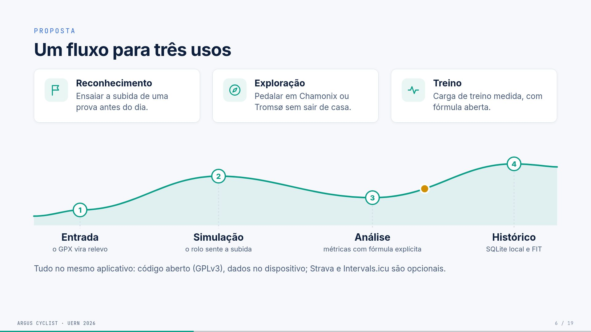

## O que aparece na tela

- **Três cartões com ícone:**
  - **Reconhecimento:** ensaiar a subida de uma prova antes do dia.
  - **Exploração:** pedalar em Chamonix ou Tromsø sem sair de casa.
  - **Treino:** carga de treino medida, com fórmula aberta.
- **Um perfil de subida** que se desenha, com um ponto amarelo (o ciclista) andando sobre ele. A cada clique entra uma estação:
  1. **Entrada:** o GPX vira relevo;
  2. **Simulação:** o rolo sente a subida;
  3. **Análise:** métricas com fórmula explícita;
  4. **Histórico:** SQLite local e FIT.
- **Último clique:** "Tudo no mesmo aplicativo: código aberto (GPLv3), dados no dispositivo; Strava e Intervals.icu são opcionais."

## Conceitos

- **Reconhecimento de percurso:** pedalar antes a rota de uma prova real para conhecer as subidas e planejar o esforço.
- **SQLite:** um banco de dados que é um arquivo local, sem servidor.
- **GPLv3:** licença de software livre. Quem distribuir versões modificadas precisa manter o código aberto.
- **Strava e Intervals.icu:** plataformas on-line para onde o Argus *pode* enviar o FIT. É opcional.

## De onde vêm os números

Chamonix e Tromsø estão no seu histórico real (`chamonix-32km.gpx`, 4 sessões; `Tromsø.gpx`, 2 sessões).

## Roteiro da fala (50 s)

"A proposta atende três usos com o mesmo fluxo: reconhecer o percurso de uma prova, explorar lugares que talvez eu nunca visite (Chamonix e Tromsø estão no meu histórico) e treinar com carga medida. O fluxo tem quatro etapas: o GPX entra e vira relevo, o rolo simula a subida, as métricas são calculadas com fórmula aberta e tudo fica guardado localmente, em SQLite e FIT. Tudo no mesmo aplicativo."

## No TCC

Cap. 1 (objetivos) e Cap. 4 ("Demonstração", os três cenários).

# Slide 7 · Construir, usar e corrigir, em ciclos

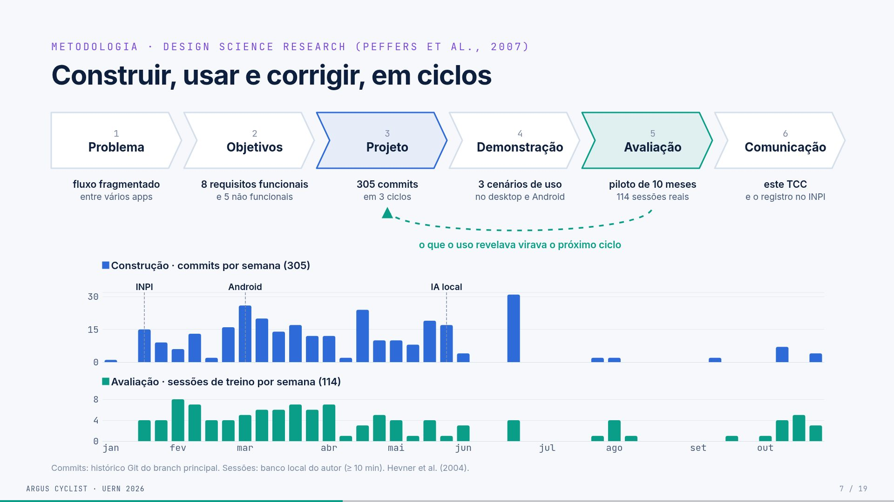

## O que aparece na tela

- **Seis setas em sequência:** as etapas da DSR de Peffers *et al.* (2007), cada uma com o que corresponde no projeto.

| # | Etapa | No Argus |
|---|---|---|
| 1 | Problema | fluxo fragmentado entre vários apps |
| 2 | Objetivos | 8 requisitos funcionais e 5 não funcionais |
| 3 | **Projeto** (azul) | 305 commits em 3 ciclos |
| 4 | Demonstração | 3 cenários de uso no desktop e no Android |
| 5 | **Avaliação** (verde) | piloto de 10 meses, 114 sessões reais |
| 6 | Comunicação | este TCC e o registro no INPI |

- **Clique 1:** uma seta tracejada volta da Avaliação para o Projeto, com a frase "o que o uso revelava virava o próximo ciclo" logo abaixo da curva.
- **Clique 2:** um gráfico em dois painéis com o mesmo eixo de tempo (jan a out/2026):
  - **em cima, Construção:** commits por semana (azul), total 305, com marcos verticais em **INPI** (20/01), **Android** (08/03) e **IA local** (27/05);
  - **embaixo, Avaliação:** sessões de treino por semana (verde), total 114.

## Conceitos

- **DSR (Design Science Research):** método de pesquisa em que o conhecimento vem de **construir e avaliar um artefato** (aqui, o software). A versão de Peffers tem seis etapas. Hevner *et al.* (2004) dão a base teórica.
- **Artefato:** o produto da pesquisa, o Argus Cyclist.
- **Ciclo iterativo:** construir, usar, achar problemas e corrigir, várias vezes.
- **Os três ciclos do TCC** são temáticos e se sobrepõem no tempo:
  1. **núcleo e linha de base,** até o registro no INPI (20/01);
  2. **análise, treino e integrações:** ZWO, testes de FTP, eventos, PMC, Strava e Intervals;
  3. **mobilidade e experiência:** Android, MapLibre, IA local e desgaste de componentes.
- **Commit:** cada alteração registrada no Git.

## De onde vêm os números

- **305 commits:** `git log` do branch `main` até 31/10/2026.
- **114 sessões:** atividades com 10 min ou mais no banco local (são 140 no total).
- Os dois saem do script `scripts/exportar_dados.py`.
- **INPI:** processo BR512026003786-7, de 20/01/2026.

**Atenção:** o TCC diz **301 commits**, porque o levantamento foi feito em 18/10. O deck usa 305, o número atualizado. Se perguntarem, explique a diferença de data.

## Roteiro da fala (1:00)

"O método é a Design Science Research: o conhecimento vem de construir e avaliar o artefato. São seis etapas, e cada uma tem um correspondente no projeto. O que importa é o laço entre projeto e avaliação: eu usava o Argus nos meus treinos, e o que dava errado virava correção no ciclo seguinte.

O gráfico mostra isso com dados reais. Em azul, a construção, em commits por semana; em verde, a avaliação, em sessões de treino por semana. As duas andam juntas de fevereiro a maio, e a avaliação continua depois. Os marcos são o registro no INPI em janeiro, o Android em março e a IA local em maio."

## Perguntas prováveis

- **(Comp.) Avaliação com um único usuário (n = 1) é suficiente para DSR?** Para um estudo piloto, sim. A DSR admite avaliação por demonstração e uso, e o TCC declara que não há inferência estatística nem estudo de usabilidade com terceiros (é trabalho futuro).
- **(Comp.) Por que os commits caem depois de junho?** O núcleo estabilizou e o trabalho passou a ser de uso e escrita. A avaliação (verde) continua até outubro.
- **(Comp.) Commits medem qualidade?** Não. O TCC diz explicitamente que o histórico é evidência de continuidade e rastreabilidade, não de qualidade.

## No TCC

Cap. 4: "Design Science Research", "Processo de desenvolvimento" (os três ciclos) e "Avaliação".

# Slide 8 · Como o Argus foi construído

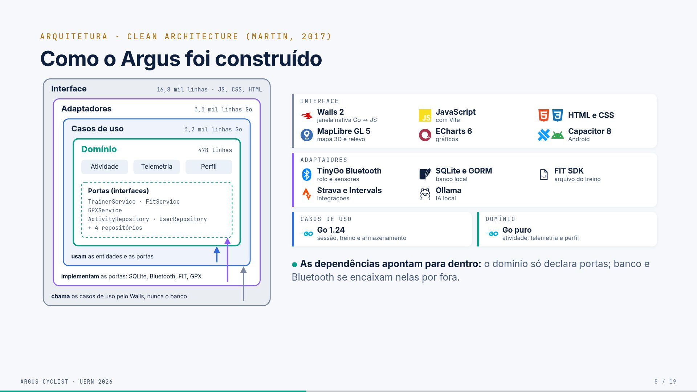

## O que aparece na tela

**À esquerda, quatro retângulos um dentro do outro** (as camadas da Clean Architecture), cada um com o nome e o tamanho em linhas de código:

- **Interface:** 16,8 mil linhas (JS, CSS e HTML);
  - **Adaptadores:** 3,5 mil linhas de Go;
    - **Casos de uso:** 3,2 mil linhas de Go;
      - **Domínio:** 478 linhas. Dentro dele estão as entidades **Atividade, Telemetria e Perfil** e uma caixa tracejada **"Portas (interfaces)"** com `TrainerService`, `FitService`, `GPXService`, `ActivityRepository`, `UserRepository` e mais 4 repositórios.

**No clique, três setas verticais coloridas**, cada uma com um verbo:

- Casos de uso **usam** as entidades e as portas;
- Adaptadores **implementam** as portas: SQLite, Bluetooth, FIT, GPX (a seta termina dentro da caixa de portas);
- Interface **chama** os casos de uso pelo Wails, nunca o banco.

**À direita,** as tecnologias com ícones, agrupadas pela cor da camada:

- **Interface:** Wails 2, JavaScript (com Vite), HTML e CSS, MapLibre GL 5, ECharts 6, Capacitor 8 (Android);
- **Adaptadores:** TinyGo Bluetooth, SQLite e GORM, FIT SDK, Strava e Intervals, Ollama;
- **Casos de uso:** Go 1.24;
- **Domínio:** Go puro.

**Frase final:** "As dependências apontam para dentro: o domínio só declara portas; banco e Bluetooth se encaixam nelas por fora."

## Conceitos

- **Clean Architecture (Martin, 2017):** organizar o código em camadas concêntricas. A regra é que **o código de dentro não conhece o de fora**: o domínio (as regras do negócio) não importa banco, Bluetooth nem interface.
- **Portas e adaptadores:** o domínio declara *interfaces* (as portas), por exemplo "um serviço de rolo deve saber `SetGrade`". Os adaptadores *implementam* essas interfaces: o Bluetooth real, um rolo virtual de teste, o SQLite. Isso permite trocar o rolo real por um simulado sem mudar as regras.
- **Inversão de dependência:** quem está fora depende de quem está dentro, nunca o contrário.
- **Tecnologias:**
  - **Go:** linguagem do núcleo, compilada e rápida.
  - **Wails:** cria um app desktop com interface web e núcleo em Go, ligando os dois (*bindings*).
  - **Capacitor:** empacota a mesma interface web como app Android.
  - **MapLibre GL:** mapa 3D de código aberto (imagens Esri e relevo AW3D30).
  - **ECharts:** gráficos.
  - **TinyGo Bluetooth:** biblioteca BLE para Go.
  - **GORM:** biblioteca que faz a ponte entre o Go e o SQLite.
  - **Ollama:** roda modelos de IA localmente.

## De onde vêm os números

Linhas não vazias, sem arquivos de teste, contadas no repositório em 01/11/2026:

- **domínio:** `internal/domain`, 478;
- **casos de uso:** `internal/usecase` (224) + `app.go`, `gamification.go` e `main.go` (3.017) = 3,2 mil;
- **adaptadores:** `internal/service` (2.731) + `internal/repository` (721) = 3,5 mil;
- **interface:** JS 8.135 + CSS 6.540 + HTML 2.081 = 16,8 mil.

## Roteiro da fala (1:10)

"A arquitetura segue a Clean Architecture. No centro está o domínio, pequeno, com 478 linhas de Go puro: atividade, telemetria, perfil e as **portas**, que são as interfaces que o sistema precisa. Os casos de uso usam essas portas. Os adaptadores, como Bluetooth, SQLite e FIT, implementam as portas por fora. E a interface chama os casos de uso pelo Wails, nunca o banco direto.

Na prática, posso trocar o rolo real por um rolo virtual de teste sem mexer nas regras. À direita está a stack: Go no núcleo, Wails no desktop, Capacitor no Android, MapLibre no mapa, ECharts nos gráficos, SQLite para os dados e Ollama para a IA local."

## Perguntas prováveis

- **(Comp.) Por que Wails e não Electron ou Tauri?** O núcleo já era Go, com biblioteca BLE em Go. Electron embutiria Node e Chromium; Tauri usaria Rust. O Wails liga o Go à interface com menos distância. O TCC é honesto: não houve *benchmark* de memória nem de tamanho. Foi adequação ao código existente.
- **(Comp.) Onde a Clean Architecture vaza?** Há duas concessões declaradas:
  1. O `app.go` concentra a orquestração da sessão: dos 3,2 mil de casos de uso, 3 mil estão nele.
  2. As entidades do domínio carregam tags do GORM (`gorm:"primaryKey"`), mas sem importar o pacote.
- **(Comp.) Por que a física é reimplementada em JS no Android?** O Capacitor não executa Go. Portar o núcleo para WebAssembly exigiria outra cadeia de compilação, fora do escopo. É a decisão mais custosa (ADR-06) e um caminho para trabalho futuro.
- **(Comp.) Por que a interface tem tantas linhas?** Porque o HUD, o mapa, os gráficos, os modais e o CSS responsivo para o celular estão nela. O CSS sozinho tem 6,5 mil linhas.

## No TCC

Cap. 5: "*Stack* tecnológica", "Clean Architecture e Ports & Adapters" e "Decisões e compensações" (tabela de ADRs).

# Slide 9 · Núcleo em Go, interface web compartilhada

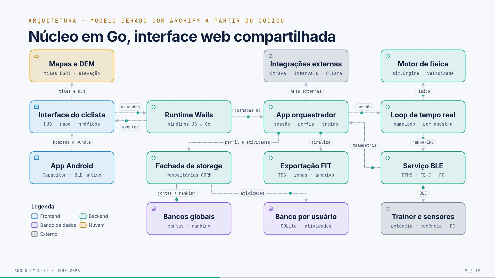

## O que aparece na tela

O diagrama de arquitetura com os 14 componentes e as 15 ligações do **modelo que o Archify gerou a partir do código**. O desenho foi redesenhado para o slide: uma grade de 4 colunas, mais compacta e com letras maiores. As ligações ficam animadas como no modo "Fluxo de sinal" do Archify: o tracejado corre no sentido da seta e um ponto verde percorre cada ligação. A legenda de cores, no canto inferior esquerdo, é: Frontend (azul), Backend (verde), Banco de dados (roxo), Nuvem (laranja) e Externo (cinza).

Siga o caminho principal pela linha do meio e depois desça pela coluna da direita:

1. **Interface do ciclista** (HUD, mapa, gráficos) ⇄ **Runtime Wails** (bindings JS ↔ Go): comandos vão, eventos voltam.
2. **App orquestrador** (sessão, perfis, treino): recebe as chamadas Go.
3. **Loop de tempo real** (gameLoop, por amostra): a sessão acontece aqui.
4. **Serviço BLE** (FTMS, FE-C, FC), logo abaixo do Loop: manda rampa/ERG para o **Trainer e sensores**, que fica embaixo dele, e devolve a telemetria ao orquestrador.

Ramificações:

- o Loop chama o **Motor de física** (`sim.Engine`, que calcula a velocidade);
- o orquestrador finaliza na **Exportação FIT** (TSS, zonas, arquivo);
- o orquestrador usa a **Fachada de storage** (repositórios GORM), que grava nos **Bancos globais** (contas, ranking) e no **Banco por usuário** (SQLite, atividades);
- o orquestrador fala com as **Integrações externas** (Strava, Intervals, Ollama);
- a Interface busca **Mapas e DEM** (tiles ESRI, elevação);
- o **App Android** (Capacitor, BLE nativo) hospeda o mesmo *bundle* da interface.

## Conceitos

- **Archify:** ferramenta que gera o diagrama a partir do código. O desenho reflete o código real, não uma idealização.
- **Bindings:** funções Go chamáveis do JavaScript, criadas pelo Wails.
- **gameLoop:** o laço da sessão que processa cada aviso dos sensores.
- **DEM:** modelo digital de elevação, a altitude do terreno para o mapa 3D.
- **Bundle:** o pacote da interface web (HTML, JS, CSS) que o Android reaproveita.

## Roteiro da fala (1:40)

"Este é o diagrama gerado pelo Archify a partir do código. Na linha do meio: a interface, o runtime Wails ligando o JavaScript ao Go, o app orquestrador e o laço de tempo real; abaixo do laço, o serviço Bluetooth, que fala com o rolo. O laço usa o motor de física para calcular a velocidade. No fim da sessão, o orquestrador exporta o FIT e grava no banco do usuário. O Android reaproveita a mesma interface, mas a física e o GPX foram reescritos em JavaScript, porque o Capacitor não roda Go."

## Perguntas prováveis

- **(Comp.) Os bancos são separados por quê?** O banco por usuário (um SQLite por perfil) isola os dados de cada ciclista. O banco global guarda as contas e o ranking dos eventos.
- **(Comp.) O app orquestrador não é um "god object"?** Em parte, sim. É a concessão declarada (ADR-08, monólito modular).

## No TCC

Cap. 5: "Topologia de componentes" e "Arquitetura móvel".

# Slide 10 · Como o Argus conversa com o rolo

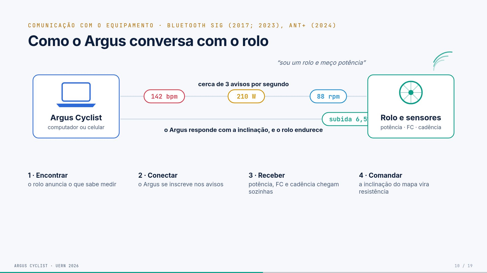

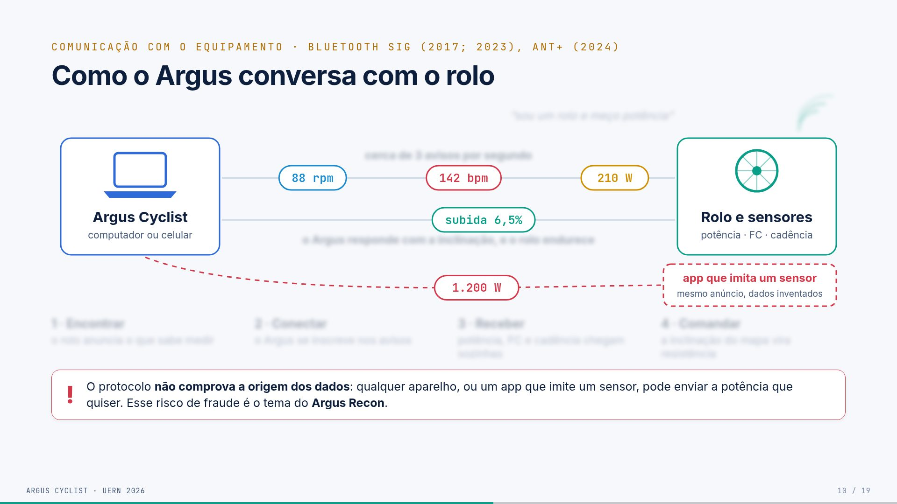

## O que aparece na tela

- **À esquerda,** o Argus Cyclist (computador ou celular). **À direita,** o rolo e os sensores (potência, FC, cadência).
- Quatro cliques constroem a conversa; os passos aparecem também numa faixa embaixo:
  1. **Encontrar:** ondas saem do rolo com "sou um rolo e meço potência" (o rolo anuncia o que sabe medir).
  2. **Conectar:** aparecem duas linhas entre os dois (o Argus se conecta e se inscreve nos avisos).
  3. **Receber:** bolhas "210 W", "142 bpm" e "88 rpm" correm do rolo para o Argus, com a legenda "cerca de 3 avisos por segundo".
  4. **Comandar:** uma bolha "subida 6,5%" vai do Argus para o rolo ("o Argus responde com a inclinação, e o rolo endurece").
- **Clique 5, o impostor:** surge um "app que imita um sensor" (mesmo anúncio, dados inventados) mandando "1.200 W" para o Argus. **Todo o resto fica desfocado** (veja as duas imagens acima). O alerta diz: "O protocolo **não comprova a origem dos dados**: qualquer aparelho, ou um app que imite um sensor, pode enviar a potência que quiser. Esse risco de fraude é o tema do **Argus Recon**."

## Conceitos

- **Bluetooth LE (Low Energy):** a versão de baixo consumo do Bluetooth, usada por sensores esportivos.
- **GATT:** a forma como o BLE organiza os dados, em *serviços* com *características*.
  - Exemplo: o serviço Cycling Power (`0x1818`) tem a característica de medição (`0x2A63`), que carrega potência e cadência.
  - Outros serviços usados: Heart Rate (`0x180D`) e Fitness Machine (`0x1826`).
- **Central e periférico:** o rolo é o periférico (servidor GATT, anuncia e guarda os dados). O Argus é a central (cliente, conecta e pede).
- **Anúncio (advertising):** o rolo transmite periodicamente "existo e ofereço este serviço".
- **Assinatura ou notificação:** o Argus pede para ser avisado quando o valor muda. A partir daí os dados chegam sozinhos, sem precisar perguntar. Tecnicamente, é escrever no descritor CCCD.
- **Escrita no ponto de controle:** é como o Argus manda comandos ao rolo (inclinação ou potência-alvo).
- **FTMS × FE-C**, os dois "idiomas" de controle:
  - **FTMS** é o padrão do Bluetooth. "Subida de 6,5%" vira 3 bytes: o comando `0x03` e o valor 65 (em décimos de por cento).
  - **FE-C** é o padrão ANT+, aqui levado ao Bluetooth. A mensagem é uma página de 8 bytes (página 51, inclinação em centésimos com deslocamento de 200%). Antes de começar, o Argus envia o perfil do ciclista (página 55) e o vento (página 50).
  - No desktop, o Argus fala os dois; no Android, só FE-C.
- **Spoofing (falsificação):** um dispositivo se passa por outro. Os perfis de ciclismo do BLE não autenticam a origem do dado.
- **Argus Recon:** o seu outro projeto, uma ferramenta de segurança para analisar o BLE de dispositivos de ciclismo (`github.com/SoNdA11/argus-recon`).

## De onde vêm os números

- **"≈ 3 avisos por segundo":** medido nas sessões reais. A Girona teve 10.870 notificações em 3.678 s ativos, ou 2,96 por segundo.
- **210 W, 142 bpm, 88 rpm e 6,5%:** são exemplos ilustrativos.

## Roteiro da fala (1:30)

"Como o Argus conversa com o rolo? Primeiro, o rolo se anuncia: 'sou um rolo e meço potência'. O Argus conecta e se inscreve para receber avisos. A partir daí os dados chegam sozinhos, cerca de três por segundo somando os sensores. No sentido contrário, o Argus envia a inclinação do mapa, e o rolo endurece.

Existe um detalhe importante: nada no protocolo prova que esses 210 watts vieram de um medidor de verdade. Um aplicativo pode se passar por sensor e mandar 1.200 watts. Em competições virtuais isso abre espaço para fraude, e é o tema do Argus Recon, um outro projeto meu."

## Perguntas prováveis

- **(Comp.) O Argus detecta o spoofing?** Não. O Argus não autentica; ele confia no sensor, como todos os apps do mercado. A análise de fraude é o objeto do Argus Recon. Só citar, não aprofundar.
- **(Comp.) FTMS foi testado?** O rolo usado nos testes fala FE-C. O caminho FTMS está implementado no desktop, mas **não foi validado com um rolo que só tenha FTMS** (Cap. 7). Há ainda um defeito conhecido, descrito no Cap. 6: o opcode `0x00` também é enviado à característica `0x2A66`.
- **(Comp.) Por que só FE-C no Android?** Foi uma decisão de escopo: o plugin Capacitor foi implementado para o caminho do hardware de teste. Implementar FTMS no Android é trabalho futuro.
- **(Comp.) Notificações podem se perder?** Sim. Se o laço estiver ocupado, uma notificação pode ser descartada, porque o canal não tem buffer. Está registrado como limitação de amostragem.

## No TCC

Cap. 3 ("Bluetooth Low Energy e o modelo GATT", "FTMS", "FE-C sobre BLE") e Cap. 6 ("Integração com o rolo").

# Slide 11 · Do sensor até o ciclista

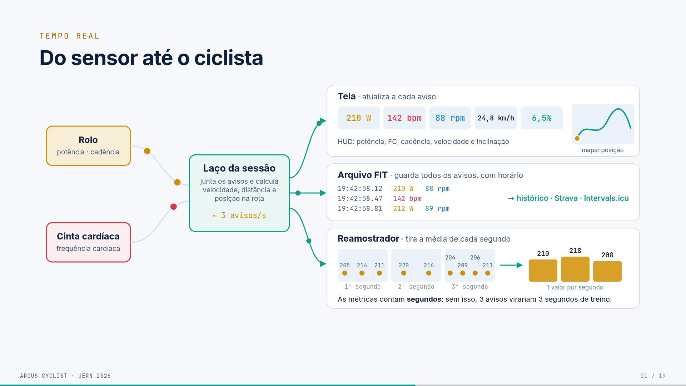

## O que aparece na tela

- **Cores:** cada cor indica de onde vem o dado. O **Rolo** é âmbar (manda potência) e a **Cinta** é vermelha (FC). O **Laço da sessão** é verde-azulado, a cor do Argus, e por isso as três setas que saem dele também são. A Tela, o Arquivo FIT e o Reamostrador têm o mesmo estilo neutro.
- **À esquerda,** o **Rolo** (potência, cadência) e a **Cinta cardíaca** (FC) mandam pacotes animados (bolinhas) para o **Laço da sessão**. O laço junta os avisos e calcula a velocidade, a distância e a posição na rota (≈ 3 avisos/s).
- Três saídas, uma por clique:
  1. **Tela** (atualiza a cada aviso): um mini HUD com 210 W, 142 bpm, 88 rpm, 24,8 km/h e 6,5%, e um mini mapa com o ciclista andando. Legenda: "HUD: potência, FC, cadência, velocidade e inclinação; mapa: posição".
  2. **Arquivo FIT** (guarda todos os avisos, com horário): três linhas de registro com horários de frações de segundo, que seguem para o histórico, o Strava e o Intervals.icu.
  3. **Reamostrador** (tira a média de cada segundo): pontos caem em três caixas, "1º, 2º e 3º segundo":
     - 1º segundo: 205, 214, 211 → **210**;
     - 2º segundo: 220, 216 → **218**;
     - 3º segundo: 204, 209, 206, 211 → **208**.
     
     Embaixo: "As métricas contam **segundos**: sem isso, 3 avisos virariam 3 segundos de treino."

## Conceitos

- **Laço da sessão (gameLoop):** o código que recebe cada aviso, atualiza a física e distribui os dados.
- **HUD:** os números sobrepostos ao mapa durante o treino.
- **Por que a tela recebe tudo:** para ficar responsiva. O mapa suaviza a câmera a cada 150 ms. A fluidez da tela não é a mesma coisa que a taxa de aquisição.
- **Por que o FIT recebe tudo:** é o registro bruto e fiel, com o horário de cada aviso, e é o que vai para as plataformas externas.
- **Reamostrador:** os sensores mandam avisos em horários irregulares, cerca de 3 por segundo. As fórmulas (NP com janela de 30 s, TSS, desacoplamento, HRR) supõem **um valor por segundo**. O reamostrador agrupa os avisos de cada segundo e tira a média.
- **O que acontecia sem ele:** 3 avisos eram contados como 3 segundos, e as métricas ficavam distorcidas. Na Girona, o NP calculado era 138 W em vez de 106 W.
- **Lacunas:** se passar mais de 5 s sem aviso, o reamostrador trata o intervalo como pausa.

## De onde vêm os números

- **Valores do reamostrador:** são um exemplo, mas a conta das médias é exata. (205+214+211)/3 = 210; (220+216)/2 = 218; (204+209+206+211)/4 = 207,5, arredondado para 208.
- **Código:** `internal/service/fit/resample.go` (`SecondResampler`), com 3 testes automatizados.

## Roteiro da fala (1:15)

"Os sensores mandam avisos quando querem, cerca de três por segundo. O laço da sessão junta tudo e calcula a velocidade pela física e a posição na rota. Os dados vão para três lugares. A tela recebe cada aviso: o HUD mostra os números e o mapa move o ciclista. O arquivo FIT guarda tudo, com o horário de cada aviso, e é o que vai para o histórico, o Strava e o Intervals.

E o reamostrador agrupa os avisos de cada segundo e tira a média, porque as fórmulas supõem um valor por segundo. Sem ele, três avisos virariam três segundos de treino. Esse defeito foi encontrado pela própria avaliação e corrigido."

## Perguntas prováveis

- **(Comp.) Por que média e não o último valor?** A média usa toda a informação do segundo e suaviza o ruído. O último valor descartaria amostras. Um segundo sem dados é tratado como pausa.
- **(Comp.) E os treinos antigos, calculados errado?** O banco guarda os valores antigos e não foi reescrito, por decisão do autor. Os números do deck foram reprocessados a 1 Hz a partir dos FIT, pelo script `recalcular`. O app corrigido já calcula certo nas sessões novas.
- **(EF) A média de um segundo muda a potência?** Não, de forma relevante. A potência média da sessão é a mesma; o que muda é o *peso* de cada segundo nas métricas.

## No TCC

Cap. 5 ("Fluxo de telemetria", ADR-04) e Cap. 3 ("Leitura, escalas e taxas de amostragem").

# Slide 12 · Cada número tem fórmula e limite

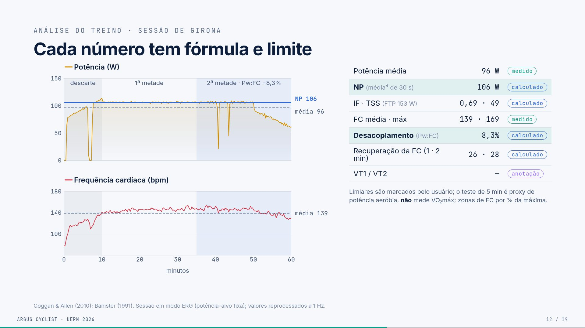

## O que aparece na tela

**À esquerda, um gráfico em dois painéis** da sessão de Girona (27/04/2026, 61 min, em modo ERG):

- **Potência (W), em amarelo:**
  - a linha tracejada cinza é a "média 96";
  - no clique, entra a linha azul "**NP 106**";
  - no clique seguinte, entram as faixas: **descarte** (0 a 10 min, cinza), **1ª metade** e **2ª metade · Pw:FC −8,3%** (azul-claro).
- **Frequência cardíaca (bpm), em vermelho:** a linha tracejada é a "média 139".

**À direita, uma tabela** cujas linhas entram por clique, cada uma com um selo (medido, calculado ou anotação):

| Métrica | Valor | Natureza |
|---|---|---|
| Potência média | 96 W | medido |
| NP (média⁴ de 30 s) | 106 W | calculado |
| IF · TSS (FTP 153 W) | 0,69 · 49 | calculado |
| FC média · máx | 139 · 169 | medido |
| Desacoplamento (Pw:FC) | 8,3% | calculado |
| Recuperação da FC (1 · 2 min) | 26 · 28 | calculado |
| VT1 / VT2 | n/a | anotação |

Nota abaixo: "Limiares são marcados pelo usuário; o teste de 5 min é proxy de potência aeróbia, **não** mede VO₂máx; zonas de FC por % da máxima."

Rodapé: "Coggan & Allen (2010); Banister (1991). Sessão em modo ERG (potência-alvo fixa); valores reprocessados a 1 Hz."

## Conceitos (o slide mais importante para o professor de EF)

**Carga externa × carga interna.** Esta é a distinção que organiza as métricas.

- **Carga externa** é o trabalho mecânico, medido pela potência: NP, IF, TSS e PMC.
- **Carga interna** é a resposta do corpo, medida pela FC: TRIMP, HRR e Pw:FC (o desacoplamento relaciona as duas).
- Nenhuma métrica mede lactato nem VO₂. No texto do TCC o conjunto aparece como "análise fisiológica"; no deck, "análise do treino".

**FTP (Functional Threshold Power).** É a maior potência que se sustenta por cerca de uma hora. O Argus estima o FTP por três testes:

- teste de rampa: melhor potência de 1 min × 0,75;
- teste de 20 min: melhor potência de 20 min × 0,95;
- teste de 5 min: melhor potência de 5 min × 0,80.

Na Girona, o FTP era 153 W (o atual é 181 W).

**NP (Normalized Power).** É a potência "equivalente" a um esforço constante. Passo a passo:

1. média móvel de 30 s da potência;
2. elevar cada valor à 4ª potência;
3. tirar a média;
4. tirar a raiz quarta.

Picos pesam mais, por isso NP (106) > média (96). Na Girona havia paradas e retomadas; essas variações sobem o NP.

**IF (Intensity Factor).** IF = NP / FTP = 106 / 153 = **0,69**. Um IF perto de 0,7 é ritmo de endurance; perto de 1,0 é limiar.

**TSS (Training Stress Score).** TSS = (segundos × NP × IF) / (FTP × 3600) × 100. Na Girona: (3678 × 106 × 0,693) / (153 × 3600) × 100 ≈ **49**. Uma hora no FTP vale 100.

**Desacoplamento aeróbio (Pw:FC).** Mede se o coração "se descola" da potência ao longo do treino:

1. descarta os primeiros 10 min (aquecimento);
2. divide o resto em duas metades;
3. calcula, em cada metade, a eficiência EF = potência média / FC média;
4. Desacoplamento = (EF₁ − EF₂) / EF₁.

O valor foi **8,3%**, acima do limiar convencional de 5%. Mas o número não diz a causa (fadiga, calor, hidratação) e é pouco informativo em percurso variável. Exige pelo menos 1 hora de dados.

**HRR (recuperação da FC).** FC no fim do esforço menos a FC 60 s e 120 s depois: **26 e 28 bpm**. Limitação declarada: usa a FC final, não o pico, e por isso pode subestimar.

**TRIMP (Banister).** Duração (min) × HRr × 0,64 × e^(1,92 × HRr), em que HRr é a fração da reserva de FC. Os coeficientes 0,64 e 1,92 são os da versão masculina, usados como base genérica.

**VT1/VT2.** São os limiares ventilatórios. O Argus **não detecta**: o usuário marca as linhas no gráfico (são uma anotação).

**Zonas de FC.** São calculadas por % da FC máxima: Z1 < 60%, Z2 de 60 a 70%, e assim por diante. É uma aproximação, não Karvonen nem LTHR.

**Selos.** "Medido" vem do sensor; "calculado" vem de fórmula; "anotação" é marcado pelo usuário. Essa é a honestidade epistêmica do trabalho.

**Modo ERG.** O rolo segura uma potência-alvo fixa, independentemente da inclinação. Por isso a linha de potência é tão plana.

## De onde vêm os números

- **Sessão:** `workouts/workout_2026-04-27_19-42-58.fit`, reprocessada a 1 Hz pelo script `TCC/registro-software/scripts/recalcular` (arquivo `recalculo-metricas.csv`).
- **Antigo × novo:** NP 138 → 106 W; desacoplamento 8,9% → 8,3%.
- **Os outros valores** (média, FC, HRR) vêm do mesmo FIT.

## Roteiro da fala (1:50)

"Este é o slide para o professor de Educação Física. A sessão é a de Girona: 61 minutos em modo ERG. A potência média foi 96 watts, e o NP foi 106. O NP é maior porque os picos pesam mais: é uma média de quarta potência. Com o FTP de 153 da época, o IF foi 0,69 e o TSS, 49.

O desacoplamento compara as duas metades depois de descartar o aquecimento: a razão entre potência e FC caiu 8,3%. Isso está acima do limiar convencional de 5%, mas o número não diz a causa.

O mais importante é o que está à direita: cada número tem um selo, medido, calculado ou anotação. E o que *não* medimos está escrito: os limiares são marcados pelo usuário, o teste de 5 minutos não mede VO₂máx e as zonas de FC são por percentual da máxima."

## Perguntas prováveis (EF)

- **O teste de 5 min mede VO₂máx?** Não. É um proxy de potência aeróbia máxima (MAP). O VO₂máx exige análise de gases.
- **Por que zonas por %FCmáx e não Karvonen ou LTHR?** É uma simplificação declarada. Karvonen e LTHR exigiriam FC de repouso confiável ou teste de limiar. Fica como melhoria futura.
- **TRIMP com coeficiente masculino?** Sim, como base genérica, sem seleção de sexo nem individualização. Está declarado no Cap. 3.
- **Se a potência era fixa (ERG), o desacoplamento vale?** É justamente o melhor cenário: com a potência quase constante, a subida relativa da FC fica mais visível. Mesmo assim, o número não diz a causa.
- **O simulador melhora o desempenho?** Não foi avaliado; não é objetivo do trabalho.

## No TCC

Cap. 3 ("Análise do treino e carga": FTP e zonas, NP/IF/TSS, TRIMP, PMC, desacoplamento e HRR) e Cap. 6 ("Métricas e análise").

# Slide 13 · Dez meses de uso real

## O que aparece na tela

- **Quatro números grandes:**
  - **114** sessões de 10 min ou mais (de 140);
  - **2.182 km** de distância virtual;
  - **92 h** de tempo ativo;
  - **282 FIT**: 98 de treino + 184 de eventos.
- **O gráfico PMC** (mar a out/2026):
  - barras cinza: TSS diário;
  - linha azul: CTL (42 dias);
  - linha vermelha: ATL (7 dias);
  - tracejado amarelo: TSB.
- Rodapé: "PMC reconstruído com as constantes do sistema (42 e 7 dias) a partir do banco local do autor."

## Conceitos

- **PMC (Performance Management Chart):**
  - **CTL ("fitness"):** média exponencial do TSS diário com constante de 42 dias. É o condicionamento acumulado.
  - **ATL ("fadiga"):** a mesma conta com 7 dias. É a carga recente.
  - **TSB ("forma"):** CTL − ATL. Negativo indica carga recente alta; positivo indica descanso.
  - Como o Argus calcula, a cada dia: CTL ← CTL + (TSS − CTL)/42 e ATL ← ATL + (TSS − ATL)/7.
- **Leitura do gráfico:** há blocos de treino (mar a mai e out), com a ATL subindo e a TSB negativa, e pausas (jun a set), com a CTL caindo devagar.

## De onde vêm os números

- **140 atividades** no banco, das quais **114** têm 10 min ou mais. As 26 curtas são testes e sessões interrompidas.
- **282 FIT** = 98 em `workouts/` + 184 em `workouts/events/`. Cada tentativa de evento (sprint, KOM, contrarrelógio) gera um FIT, mas não entra no histórico de treinos. Os FIT de jan a mar não ficaram no disco.
- **2.182 km e 92 h:** soma das 114 sessões.
- **Atenção:** o TCC diz **274 FIT** (levantamento de 18/10). O deck usa 282, a contagem atualizada.

## Roteiro da fala (1:00)

"Os números documentam uso continuado, não desempenho: 114 sessões, 2.182 quilômetros e 92 horas em dez meses. O PMC mostra blocos de treino, de março a maio e em outubro, e pausas no meio do ano. A CTL é o condicionamento de 42 dias, a ATL a fadiga de 7 dias, e a TSB a diferença entre as duas."

## Perguntas prováveis

- **Por que 114 e 282 são diferentes?** Contam coisas diferentes: 114 são treinos de 10 min ou mais; 282 são arquivos FIT, incluindo 184 tentativas do modo eventos.
- **(EF) A CTL ficou baixa (~20). Isso diz algo do atleta?** Diz só que o volume foi moderado e irregular. O objetivo era avaliar o software, não o atleta.

## No TCC

Cap. 3 ("PMC: CTL, ATL e TSB") e Cap. 7 ("Estudo piloto").

# Slide 14 · Do treino à análise

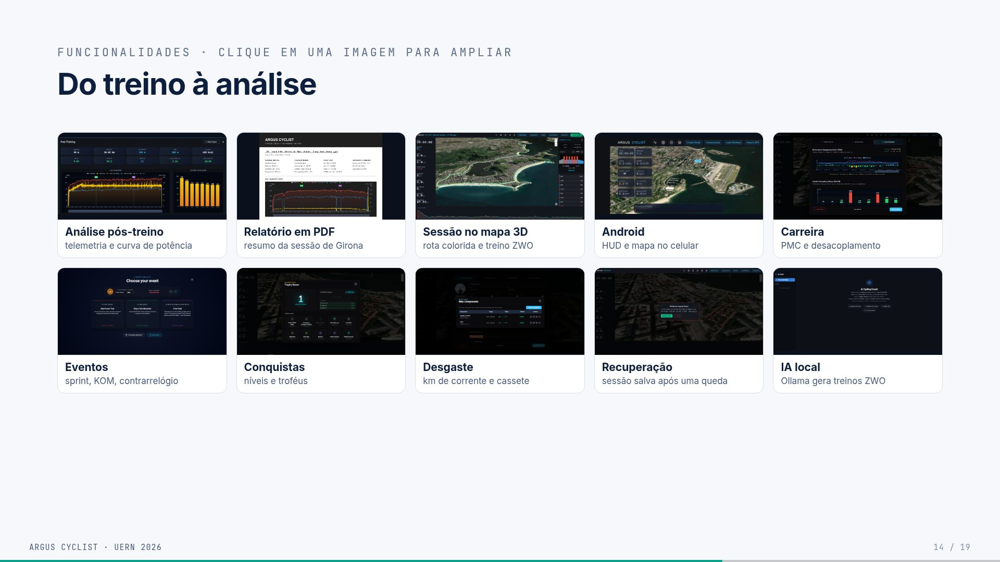

## O que aparece na tela

Uma galeria 5 × 2. **Clicar abre a imagem ampliada** com o fundo desfocado; ← → passam e `Esc` fecha.

| Imagem | O que mostra |
|---|---|
| Análise pós-treino | telemetria completa e curva de potência de uma atividade |
| Relatório em PDF | resumo exportado da sessão de Girona |
| Sessão no mapa 3D | rota colorida por inclinação e treino ZWO |
| Android | HUD e mapa no celular |
| Carreira | PMC e desacoplamento ao longo do tempo |
| Eventos | sprint, KOM e contrarrelógio |
| Conquistas | níveis e troféus (gamificação) |
| Desgaste | km de corrente e cassete |
| Recuperação | sessão salva após uma queda do app |
| IA local | o Ollama gera treinos no formato ZWO |

## Conceitos

- **ZWO:** o formato de treino estruturado (blocos de aquecimento, intervalos e desaquecimento) criado pela Zwift.
- **KOM (King of the Mountain):** prova de subida.
- **Recuperação de sessão:** durante o treino, o Argus grava um *snapshot* contínuo (metadados mais amostras em NDJSON). Se o app fechar, ao reabrir ele oferece "Recover & Save". É o RNF04, e tem 12 testes.
- **IA local:** o Ollama roda um modelo de linguagem no próprio computador, sem enviar dados para fora. A IA **só valida o formato** do treino, não a adequação fisiológica.

## De onde vêm as imagens

- O relatório PDF e a tela de recuperação foram capturados em 01/11/2026 de uma **cópia** do app e dos dados. Na cópia, a Girona recebeu as métricas reprocessadas (NP 106), para o relatório bater com o slide 12.
- O print da IA é seu, recortado para tirar o seletor de modelo que mostrava "error".

## Roteiro da fala (1:00)

"Estas são as telas reais. Ao abrir uma atividade do histórico, o Argus mostra a telemetria e a curva de potência, e o resumo pode ser exportado em PDF. Aqui está o Android, com a mesma interface. E há os eventos, as conquistas, o desgaste de componentes, a recuperação de sessão se o app cair e a IA local que gera treinos."

## Perguntas prováveis

- **(Comp.) A IA pode gerar um treino perigoso?** A validação é só sintática (o formato ZWO). Não há validação fisiológica, e isso está declarado (ADR-07).
- **(EF) A IA usa o histórico do atleta?** Em parte. O *prompt* de sistema leva o perfil (FTP, peso) e um resumo das **últimas 10 atividades** e dos totais (`internal/service/ai/prompts.go`). Uma busca no histórico completo (recuperação de informação, RAG) é trabalho futuro (Cap. 8).

## No TCC

Cap. 6 ("Exportação FIT e recuperação", "Assistente local", "Modo Android") e Cap. 7 ("Avaliação funcional").

# Slide 15 · Requisitos atendidos

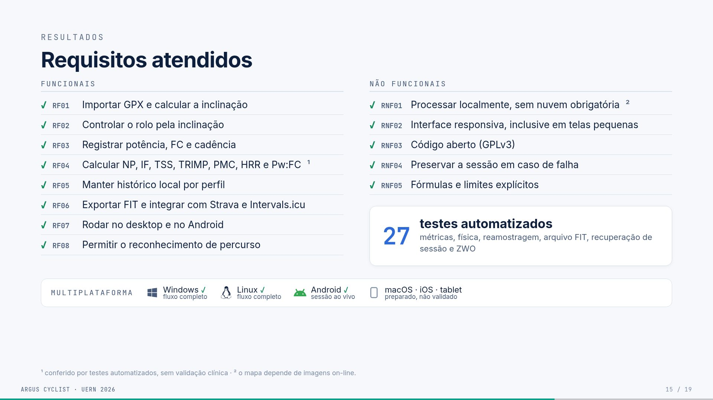

## O que aparece na tela

**Duas listas com ✓.**

**Funcionais:**

- RF01: importar GPX e calcular a inclinação;
- RF02: controlar o rolo pela inclinação;
- RF03: registrar potência, FC e cadência;
- RF04: calcular NP, IF, TSS, TRIMP, PMC, HRR e Pw:FC¹;
- RF05: manter histórico local por perfil;
- RF06: exportar FIT e integrar com Strava e Intervals.icu;
- RF07: rodar no desktop e no Android;
- RF08: permitir o reconhecimento de percurso.

**Não funcionais:**

- RNF01: processar localmente, sem nuvem obrigatória²;
- RNF02: interface responsiva, inclusive em telas pequenas;
- RNF03: código aberto (GPLv3);
- RNF04: preservar a sessão em caso de falha;
- RNF05: fórmulas e limites explícitos.

**Cartão "27 testes automatizados":** métricas, física, reamostragem, arquivo FIT, recuperação de sessão e ZWO.

**Faixa "Multiplataforma":**

- Windows ✓ e Linux ✓, fluxo completo;
- Android ✓, sessão ao vivo;
- macOS, iOS e tablet: preparado, não validado.

**Notas de rodapé:**

- ¹ conferido por testes automatizados, sem validação clínica;
- ² o mapa depende de imagens on-line.

## Conceitos

- **Requisito funcional:** o *que* o sistema faz.
- **Requisito não funcional:** *como* o sistema é (local, aberto, responsivo, robusto).
- **Os 27 testes** (`go test ./...`):
  - 7 de métricas (NP, IF/TSS, zonas de potência, zonas de FC, TRIMP, desacoplamento, PMC);
  - 2 de física (equação de Martin);
  - 3 do reamostrador;
  - 2 de FIT (round-trip e tempo derivado dos registros);
  - 12 de recuperação de sessão;
  - 1 de ZWO.

## O detalhe de cada requisito (para a fala, se perguntarem)

- **RF01 a RF05:** verificados no uso.
- **RF06:** verificado em amostra (Strava e Intervals aceitaram os FIT).
- **RF07:** fluxo completo no Windows e Linux; sessão ao vivo no Android.
- **RF08:** demonstrado com o caso Geraardsbergen a Leberg (Bélgica), o cenário de reconhecimento do Cap. 4.

## Roteiro da fala (50 s)

"Todos os requisitos foram atendidos. As métricas são conferidas por 27 testes automatizados, mas sem validação clínica, porque não medimos lactato nem VO₂máx. Tudo roda localmente; a exceção são as imagens do mapa. E 'multiplataforma' aqui significa o que foi exercitado de fato: Windows e Linux com o fluxo completo e o Android com a sessão ao vivo. macOS e iOS estão preparados, mas não validados."

## Perguntas prováveis

- **(Comp.) Testes garantem que as métricas estão corretas?** Garantem que o código implementa a fórmula documentada. Isso não equivale a validação clínica nem a comparação com equipamento de laboratório.
- **(Comp.) Por que só 27 testes?** O foco foram as partes críticas (métricas, física, dados e recuperação). Cobrir a interface e o BLE com hardware fica para trabalho futuro.

## No TCC

Cap. 4 ("Problema, requisitos e escopo") e Cap. 7 ("Avaliação funcional", "Avaliação de plataformas").

# Slide 16 · Conclusão

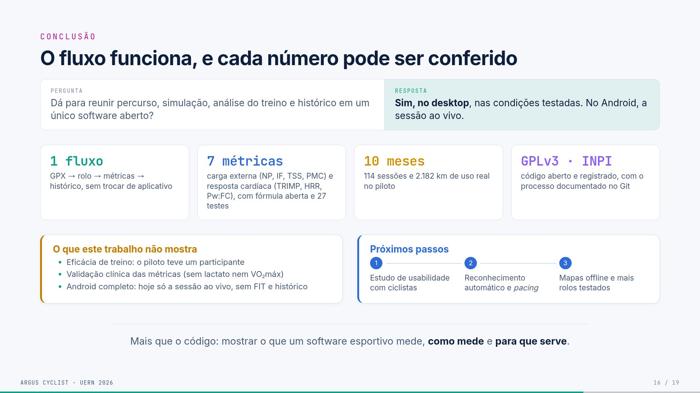

## O que aparece na tela

- **Título:** "O fluxo funciona, e cada número pode ser conferido".
- **Pergunta:** "Dá para reunir percurso, simulação, análise do treino e histórico em um único software aberto?"
- **Resposta:** "**Sim, no desktop**, nas condições testadas. No Android, a sessão ao vivo."
- **Quatro provas:**
  - **1 fluxo:** GPX → rolo → métricas → histórico, sem trocar de aplicativo;
  - **7 métricas:** carga externa (NP, IF, TSS, PMC) e resposta cardíaca (TRIMP, HRR, Pw:FC), com fórmula aberta e 27 testes;
  - **10 meses:** 114 sessões e 2.182 km de uso real no piloto;
  - **GPLv3 · INPI:** código aberto e registrado, com o processo documentado no Git.
- **O que este trabalho não mostra:**
  - eficácia de treino (o piloto teve um participante);
  - validação clínica das métricas (sem lactato nem VO₂máx);
  - Android completo (hoje, só a sessão ao vivo, sem FIT e histórico).
- **Próximos passos:**
  1. estudo de usabilidade com ciclistas;
  2. reconhecimento automático e *pacing*;
  3. mapas offline e mais rolos testados.
- **Frase final:** "Mais que o código: mostrar o que um software esportivo mede, **como mede** e **para que serve**."

## Conceitos

- **Pacing:** estratégia de distribuição do esforço ao longo de uma prova (por exemplo, quanto empurrar em cada subida).
- **A ressalva "nas condições testadas":** a confirmação é de engenharia (o fluxo funciona), não de eficácia de treino nem de usabilidade por terceiros.

## Roteiro da fala (1:15)

"Voltando à pergunta do início: dá para reunir percurso, simulação, análise do treino e histórico num só software aberto? No desktop, sim, nas condições testadas; no Android, a sessão ao vivo.

As provas são quatro: um fluxo sem trocar de aplicativo; sete métricas com fórmula aberta e 27 testes; dez meses de uso real; e o código aberto e registrado.

E o que este trabalho não mostra: eficácia de treino, porque foi um participante; validação clínica; e o Android completo. Os próximos passos são um estudo com ciclistas, o reconhecimento automático com *pacing* e os mapas offline.

Para fechar: mais que o código, a contribuição é mostrar o que um software esportivo mede, como mede e para que serve."

## No TCC

Cap. 8 inteiro: síntese, contribuições, limitações, trabalhos futuros e considerações finais.

# Slides 17 e 18 · Referências

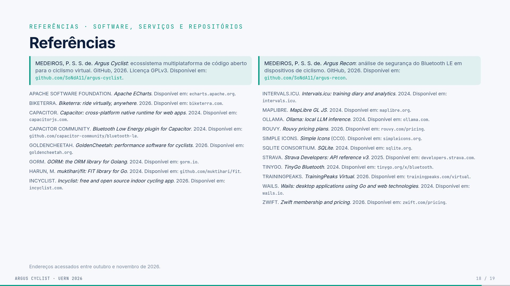

## O que aparece na tela

- **Slide 17, obras e especificações (15):** ANT+ FE-C, Banister (1991), Bluetooth Core 5.4, Bluetooth FTMS, Coggan & Allen (2010), GPLv3, Garmin FIT SDK, Hevner *et al.* (2004), o certificado do INPI, Kleppmann *et al.* (2019, local-first), Martin *et al.* (1998, modelo de potência), Martin (2017, Clean Architecture), Peffers *et al.* (2007), GPX 1.1 e UCI.
- **Slide 18, software, serviços e repositórios (21):** em destaque, os **seus dois repositórios**, *Argus Cyclist* (GPLv3) e *Argus Recon*. Depois, as tecnologias e plataformas citadas: ECharts, Biketerra, Capacitor e o plugin BLE, GoldenCheetah, GORM, muktihari/fit, Incyclist, Intervals.icu, MapLibre, Ollama, Rouvy, Simple Icons, SQLite, Strava, TinyGo, TrainingPeaks Virtual, Wails e Zwift.

## Conceitos

- **Local-first (Kleppmann):** princípio de que o dado mora no dispositivo do usuário, e a nuvem é opcional.
- **Martin *et al.* (1998):** o modelo físico que relaciona potência, peso, inclinação, arrasto e velocidade. O Argus usa esse modelo para calcular a velocidade virtual. As constantes são ρ = 1,225, CdA = 0,32, Crr = 0,005 e η = 0,96, e a equação é resolvida por bisseção.

## Roteiro

Não se fala nada; o slide passa em 5 s. Serve para a banca consultar durante a arguição.

# Slide 19 · Obrigado

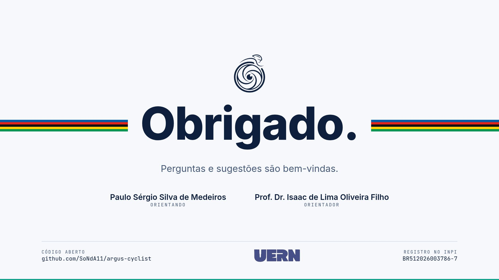

## O que aparece na tela

O slide repete a assinatura da capa: o símbolo do Argus e a faixa arco-íris, agora interrompida por "Obrigado.". Abaixo, a frase "Perguntas e sugestões são bem-vindas." e os nomes (Paulo Sérgio Silva de Medeiros, orientando; Prof. Dr. Isaac de Lima Oliveira Filho, orientador). No rodapé: o repositório (github.com/SoNdA11/argus-cyclist) à esquerda, o logo da UERN no centro e o registro no INPI (BR512026003786-7) à direita.

## Roteiro (15 s)

"Agradeço à banca, ao meu orientador e a todos. Fico à disposição para as perguntas. Depois da arguição, posso mostrar o equipamento funcionando."

Deixe este slide na tela durante toda a arguição: o repositório e o número do registro ficam à vista se a banca perguntar.

# Glossário

**ATL (Acute Training Load):** "fadiga"; média exponencial de 7 dias do TSS.

**Bisseção:** método numérico que acha a raiz de uma equação dividindo um intervalo ao meio repetidamente. O Argus usa para achar a velocidade que equilibra a potência na equação de Martin.

**BLE (Bluetooth Low Energy):** Bluetooth de baixo consumo, usado por sensores esportivos.

**Cadência:** pedaladas por minuto (rpm).

**Capacitor:** ferramenta que transforma uma interface web em app Android (e iOS).

**Carga externa:** o trabalho mecânico, medido pela potência (NP, IF, TSS, PMC).

**Carga interna:** a resposta do corpo, medida pela FC (TRIMP, HRR, Pw:FC).

**CCCD:** descritor BLE onde se escreve para ativar as notificações.

**Central / periférico:** no BLE, quem conecta e pede (central, o Argus) e quem anuncia e serve (periférico, o rolo).

**Clean Architecture:** organização em camadas em que as dependências apontam para dentro, para o domínio.

**CTL (Chronic Training Load):** "condicionamento"; média exponencial de 42 dias do TSS.

**Desacoplamento (Pw:FC):** queda da razão potência/FC entre a 1ª e a 2ª metade do treino, depois de descartados os 10 min iniciais.

**DEM:** modelo digital de elevação (altitude do terreno).

**DSR (Design Science Research):** método de pesquisa baseado em construir e avaliar um artefato.

**ERG (modo):** o rolo mantém uma potência-alvo fixa.

**FC:** frequência cardíaca, em batimentos por minuto (bpm).

**FE-C:** perfil ANT+ de controle de equipamentos de fitness, usado pelo Argus sobre Bluetooth. As mensagens são páginas de 8 bytes.

**FIT:** formato binário de atividade da Garmin; o padrão do mercado.

**FTMS:** serviço Bluetooth padrão para máquinas de fitness. Os comandos são curtos, enviados ao ponto de controle `0x2AD9`.

**FTP (Functional Threshold Power):** potência sustentável por cerca de uma hora.

**GATT:** a estrutura de serviços e características do BLE.

**GORM:** biblioteca Go que liga o código ao banco SQLite.

**GPX:** formato de percurso (pontos com latitude, longitude e altitude).

**HRR (Heart Rate Recovery):** queda da FC em 1 e 2 minutos após o esforço.

**HUD:** os números sobrepostos ao mapa durante o treino.

**IF (Intensity Factor):** NP ÷ FTP.

**MapLibre GL:** biblioteca aberta de mapas 3D.

**NP (Normalized Power):** raiz quarta da média da 4ª potência das médias móveis de 30 s.

**Ollama:** plataforma que roda modelos de IA localmente.

**PMC (Performance Management Chart):** o gráfico de CTL, ATL e TSB.

**Portas e adaptadores:** interfaces declaradas no domínio (portas) e implementações concretas fora dele (adaptadores).

**Reamostrador:** componente que transforma os ~3 avisos por segundo em 1 valor por segundo (a média), para as métricas.

**SIM (modo):** o rolo segue a inclinação do percurso.

**SQLite:** banco de dados em arquivo local, sem servidor.

**TRIMP:** impulso de treino de Banister, baseado em FC e duração.

**TSB (Training Stress Balance):** "forma"; CTL − ATL.

**TSS (Training Stress Score):** carga da sessão; 1 hora no FTP vale 100.

**VT1/VT2:** limiares ventilatórios; no Argus são anotados manualmente.

**Wails:** framework que cria apps desktop com interface web e núcleo em Go.

**ZWO:** formato de treino estruturado da Zwift.

# Números para decorar

| Número | O que é | Fonte |
|---|---|---|
| 20/01/2026 | registro no INPI (BR512026003786-7) | certificado |
| 305 | commits no `main` até 31/10 (o TCC diz 301, levantados em 18/10) | `git log` |
| 3 | ciclos de desenvolvimento | Cap. 4 |
| 140 / 114 | atividades no histórico / com 10 min ou mais | banco local |
| 2.182 km · 92 h | distância e tempo das 114 sessões | banco local |
| 282 | FIT: 98 de treino + 184 de eventos (o TCC diz 274) | `workouts/` |
| 27 | testes: 7 métricas, 2 física, 3 reamostrador, 2 FIT, 12 recuperação, 1 ZWO | `go test` |
| ≈ 3/s | avisos dos sensores (Girona: 2,96 por segundo) | `recalculo-metricas.csv` |
| 61 min | duração da sessão de Girona (27/04/2026, ERG) | FIT |
| 96 / 106 W | potência média / NP na Girona | FIT reprocessado |
| 153 W | FTP na época (hoje 181 W) | perfil |
| 0,69 · 49 | IF · TSS na Girona | fórmula |
| 139 · 169 | FC média · máxima | FIT |
| 8,3% | desacoplamento (antes do reprocessamento: 8,9%) | recálculo |
| 26 · 28 | HRR de 1 e 2 min (bpm) | FIT |
| 42 / 7 | constantes da CTL e da ATL (dias) | `metrics.go` |
| 30 s | janela do NP | `metrics.go` |
| 10 min | descarte inicial do desacoplamento | `metrics.go` |
| 0,75 / 0,95 / 0,80 | fatores do FTP (rampa / 20 min / 5 min) | Cap. 3 |
| 478 / 3,2 mil / 3,5 mil / 16,8 mil | linhas: domínio / casos de uso / adaptadores / interface | contagem de 01/11 |
| US$ 19,99 · € 19,99 | mensalidade Zwift · Rouvy (out/2026) | páginas oficiais |

# Pontos delicados e respostas honestas

**1. "Só você testou? n = 1?"** Sim. É um estudo piloto com o próprio autor, sem grupo de controle nem instrumento de usabilidade. A conclusão é de engenharia (o fluxo funciona), não de eficácia. O estudo com ciclistas é o primeiro dos próximos passos.

**2. "As métricas são validadas?"** Não clinicamente. Os testes conferem que o código implementa a fórmula documentada. Não medimos lactato nem VO₂, e as métricas são as convenções do mercado (Coggan, Banister).

**3. "O FTMS funciona?"** Está implementado no desktop, mas o rolo dos testes fala FE-C. **Não foi validado com um rolo só FTMS.** Há um defeito conhecido (o opcode `0x00` também vai para `0x2A66`), descrito no Cap. 6. No Android, só FE-C.

**4. "O Android é equivalente?"** Não. É a sessão ao vivo (GPX, ZWO, BLE/FE-C, HUD). Não exporta FIT, não tem histórico e a física foi reescrita em JS.

**5. "O app mostra NP 138 na Girona, e o slide diz 106."** A avaliação encontrou um defeito: os sensores mandam ~3 avisos por segundo, e as métricas tratavam cada aviso como um segundo. Foi corrigido com o reamostrador a 1 Hz. O banco guarda os valores antigos por decisão do autor; os números do deck foram reprocessados a partir dos FIT. **Se for fazer a demo, saiba disso antes.**

**6. "Na tela do app, VT2 aparece abaixo do VT1, e a curva de potência mostra 373 W em 1 min."** Os VT são anotação manual do usuário, e aquela marcação está errada. A curva de potência da tela de análise (no *frontend*) ainda conta amostras como segundos e mostra o valor antigo; o valor corrigido de 1 min é cerca de 148 W. **Evite abrir essa tela na demo**, ou explique.

**7. "Por que o TCC diz 'análise fisiológica' e o slide diz 'análise do treino'?"** Por precisão: NP, IF, TSS e PMC são carga externa (potência); TRIMP, HRR e Pw:FC são carga interna (FC). No texto o conjunto aparece como "análise fisiológica"; no deck, a divisão mais exata.

**8. "A Clean Architecture é respeitada?"** Em grande parte, com duas concessões declaradas: o `app.go` concentra a orquestração (3 mil linhas), e as entidades do domínio carregam tags do GORM sem importar o pacote.

**9. "É 100% offline?"** O dado e o processamento são locais. As imagens do mapa vêm da internet, e mapas offline são trabalho futuro.

**10. "Os tokens do Strava são seguros?"** Ficam em texto simples no SQLite, sem criptografia nem *keyring*. Está declarado no Cap. 5 como limitação.

**11. "Latência e memória foram medidas?"** Não. Houve estimativas informais, e o TCC diz "não medido". Não cite números.

# Banco de perguntas extras

## Computação

- **Por que Go?** É compilado, leve, tem boa concorrência (as *goroutines* para o laço e o BLE) e havia biblioteca BLE (TinyGo).
- **Por que não WebAssembly para unificar o núcleo?** Exigiria outra cadeia de compilação e uma ponte com o BLE nativo, fora do escopo. É o caminho mais coerente para o futuro.
- **Por que SQLite por perfil?** Isola o dado de cada ciclista e não precisa de servidor. O custo é não ter sincronização.
- **Por que não um servidor?** Traria contas, LGPD, custo e disponibilidade. Para um TCC com foco local, o monólito modular basta e é mais fácil de auditar.
- **O registro do INPI diz "HTML; JavaScript" e o núcleo é Go?** O registro foi da linha de base de janeiro, com a declaração feita naquele momento. O núcleo em Go está documentado no TCC. Se perguntarem, explique que é a descrição do formulário da época.
- **Como o FIT foi validado?** Strava e Intervals aceitaram os arquivos. Também foi encontrado e corrigido um defeito em que campos não preenchidos eram gravados como zero válido (altitude −500 m). Há testes de *round-trip*.
- **O que acontece se o app fechar no meio do treino?** O snapshot de recuperação guarda os metadados e as amostras. Ao reabrir, o app oferece salvar (RNF04, 12 testes).
- **Por que o diagrama do slide 9 é do Archify?** Porque é gerado do código, então mostra a arquitetura real e não a ideal.

## Educação Física

- **O que é FTP e por que os fatores 0,75, 0,95 e 0,80?** É a potência sustentável por cerca de uma hora. Os fatores convertem a melhor potência de cada teste (rampa, 20 min, 5 min) numa estimativa do FTP, seguindo as convenções da literatura de treino com potência (Coggan & Allen).
- **VT1/VT2 são detectados?** Não. São marcados pelo usuário.
- **HRR usa o pico?** Não. Usa a FC no fim do esforço, o que pode subestimar a recuperação; está declarado.
- **Zonas por %FCmáx são adequadas?** São uma aproximação simples. Karvonen ou LTHR seriam melhores, e ficam como melhoria futura.
- **TRIMP masculino em uma mulher?** Os coeficientes são genéricos (versão masculina), sem seleção de sexo. É uma limitação declarada.
- **A velocidade virtual é real?** Não. É estimada pelo modelo de Martin a partir da potência medida, do peso e da inclinação. A potência é medida; a velocidade, calculada.

# Checklist do dia

**Na véspera**

- [ ] Ensaiar duas vezes inteiro com a visão do apresentador (`S`) e conferir o tempo (meta: 17 a 18 min).
- [ ] Gerar o PDF de contingência (`npm run pdf`) e copiar para o pendrive junto com a pasta `TCC/apresentacao` (sem `node_modules`).
- [ ] Carregar o notebook e o celular. Conferir o pareamento do rolo e da cinta para a demo após a arguição.

**Na sala**

- [ ] Abrir `index.html` no Chrome/Chromium com o Wi-Fi desligado. O deck é 100% offline (o mapa da galeria são imagens).
- [ ] Testar no projetor. Se as cores lavarem, usar o tema escuro (`T`).
- [ ] Apertar `F` para a tela cheia e `S` para abrir a visão do apresentador no notebook.
- [ ] Deixar o slide 19 (Obrigado) na tela durante a arguição.
- [ ] Na demo, evitar a tela de análise da Girona (pontos delicados 5 e 6), ou explicá-la.
